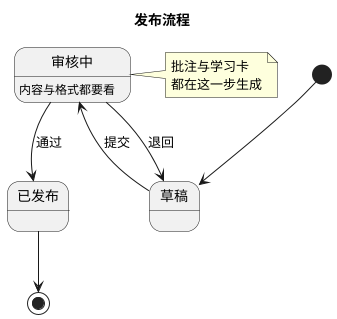
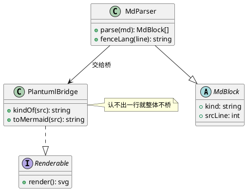
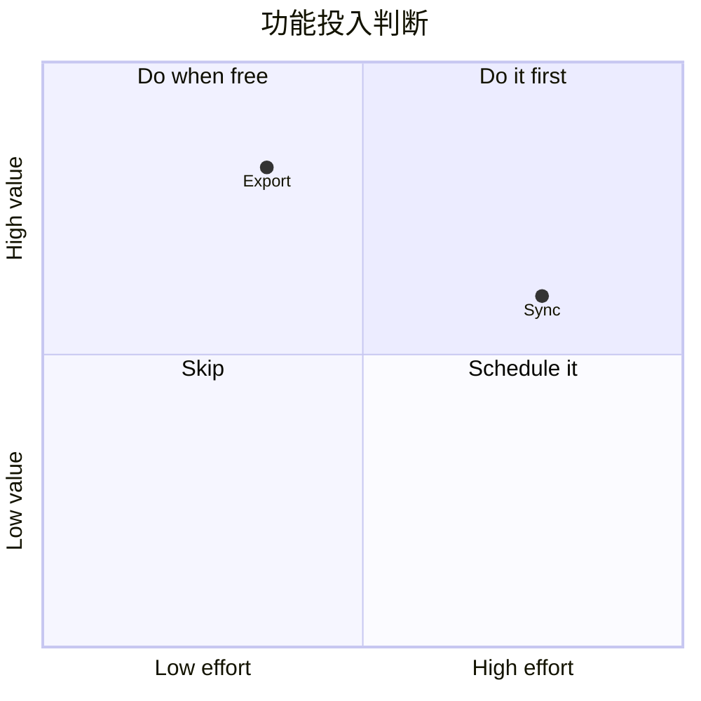
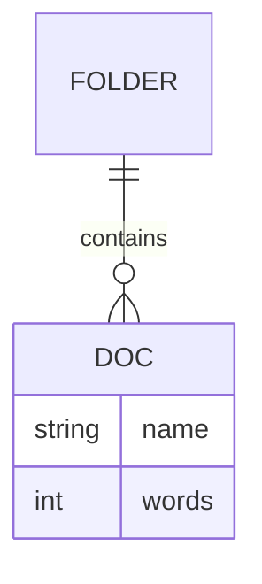
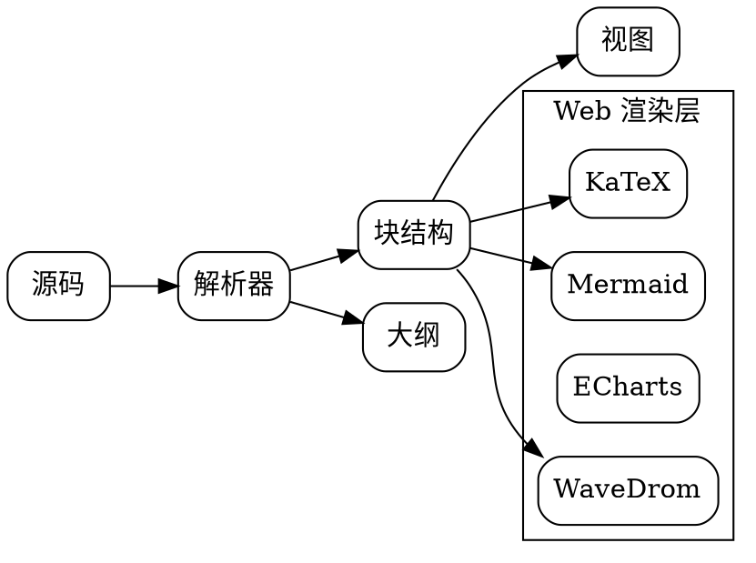

# 澄笺 · 渲染能力总览

> [!NOTE]
> 这份文档是**能力清单**，不是教程（教程见「Markdown 语法教程」，功能演示见「澄笺示例 · 全功能演示」）。
> 下面每一条都在开发机上用**应用自带的离线渲染库真跑过**，标注了「实测」；
> 只有官方文档写着、这里没实测过的，一律标「未验证」或直接列入文末的不支持清单。
> 版本与开关入口见每节末尾，或「设置 → 引擎管理」。

---

## 一、图表引擎一览

正文里把围栏代码块的语言名写成下面任意一个，就会**渲染成图**而不是代码：

| 语言名 | 引擎 | 版本 | 用来画 |
| --- | --- | --- | --- |
| `mermaid`（别名 `mmd`） | Mermaid | 11.17.2 | 流程图、时序图、类图、状态图、ER 图、甘特、饼图、思维导图、时间线、C4、看板、数据包、架构图、块图、象限、需求、git 分支等 |
| `echarts` | Apache ECharts | 6.1.0 | 统计图（柱 / 折线 / 饼 / 散点 / 雷达 / 仪表盘 / 关系图 / 树 / 矩形树图 等） |
| `markmap` | markmap | 0.18.12 | 思维导图（Markdown 大纲直接成图） |
| `graphviz`（别名 `dot` / `gv` / `viz`） | Viz.js（内嵌 Graphviz 16.1.0） | 3.31.0 | DOT 语言关系图、有向图、聚类 |
| `nomnoml`（别名 `noml` / `nml`） | nomnoml（UMD，只依赖 graphre） | 1.x | 极简 UML：`[A] -> [B]`、`[类\|字段\|方法]` |
| `chart`（别名 `chartjs` / `chart.js`） | Chart.js | 4.5.1 | 统计图，配置写 JSON（与 `echarts` 重叠，写法不同） |
| `vega-lite`（别名 `vl` / `vega`） | Vega 6.4.0 + Vega-Lite 6.5.0（BSD-3-Clause） | 6.5.0 | 声明式统计图：JSON spec 写 `data` / `mark` / `encoding`，出**矢量 SVG**；分面、聚合、交互选择子集都认 |
| `flowchart` | flowchart.js | 1.17.1 | 经典 `st=>start:` 写法的流程图 |
| `abc` | abcjs | 6.7.1 | ABC 记谱法五线谱 |
| `wavedrom` | WaveDrom | 3.7.0 | **数字波形图**、逻辑门图、寄存器位段图 |
| `html` | 系统 WebView | — | 可交互 HTML 预览（`<script>` 会执行） |
| `katex` / `$$…$$` | KaTeX | 0.19.0 | 数学公式 |

**关闭某个引擎**：设置 → 引擎管理。关闭后该语言的代码块在阅读页与导出 HTML 里
都退回成**普通代码块**（不会渲染失败留白），导出的网页也不会假装能渲染。

### 随包库版本巡检（2026-10-14，逐个对过 npm 最新版）

版本号一律从**实际文件**里读出来对，不抄声明：

| 库 | 随包 | npm 最新 | 结论 |
| --- | --- | --- | --- |
| KaTeX | 0.19.0 | 0.19.0 | 已最新 |
| Mermaid | 11.17.2 | 12.2.0 | **不升**：33 个样本实测 12.2.0 把 `requirementDiagram` 跑挂，且时序图参与者类型、C4 画法都没改善 |
| markmap-lib / -view | 0.18.12 | 0.18.12 | 已最新 |
| d3 | 7.9.0 | 7.9.0 | 已最新 |
| Apache ECharts | 6.1.0 | 6.1.0 | 已最新 |
| abcjs | 6.7.1 | 6.7.1 | 已最新 |
| Viz.js（Graphviz 16.1.0） | 3.31.0 | 3.31.0 | 已最新 |
| WaveDrom | 3.7.0 | 3.7.0 | 已最新 |
| nomnoml | 1.7.0 | 1.7.0 | 已最新 |
| Chart.js | **4.5.1** | 4.5.1 | 本轮升级（原 4.4.7；升级后浏览器实测仍正常出图） |
| Vega / Vega-Lite | 6.4.0 / 6.5.0 | 6.4.0 / 6.5.0 | 已最新（本轮刚引入） |
| flowchart.js | 1.17.1 | 1.18.0 | **不升**：1.18.0 的 npm 包里只剩 `src/` 与 `index.js`，**不再发布浏览器 UMD**，接它得自搭 bundler，而这是条借 raphael 画的老引擎 |
| MathJax | 3.2.2 | 4.1.3 | **不升**：v4 要 API 适配（`mjformula.html` 的加载与 `tex.packages` 配置按 v3 写）；它是 KaTeX 之外的兜底引擎，动它风险大于收益 |
| marked | **18.1.1** | 18.1.1 | 本轮升级（编辑器即时渲染用；Node 里跑过一遍解析自检） |
| turndown | 7.2.4 | 7.2.4 | 已最新 |

巡检顺带修了一处**声明与实际不符**：引擎管理页里 Mermaid 一直写着 10.9.3，
而随包文件早就是 11.17.2 —— 界面上的版本号也是承诺，不能滞后于包里真正带的东西。

---

## 二、Mermaid：实测可用的图类型

Mermaid 官方类型很多，但**能不能画取决于应用内置的这份构建**。逐个实测结果：

| 图类型 | 首行写法 | 实测 |
| --- | --- | :---: |
| 流程图 | `graph TD` / `flowchart LR` | ✅ |
| 时序图 | `sequenceDiagram` | ✅ |
| 类图 | `classDiagram` | ✅ |
| 状态图 | `stateDiagram-v2` | ✅ |
| 实体关系图 | `erDiagram` | ✅ |
| 用户旅程图 | `journey` | ✅ |
| 甘特图 | `gantt` | ✅ |
| 饼图 | `pie` | ✅ |
| 象限图 | `quadrantChart` | ✅ |
| 桑基图 | `sankey-beta` | ✅ |
| 柱线混合图 | `xychart-beta` | ✅ |
| 需求图 | `requirementDiagram` | ✅ |
| Git 分支图 | `gitGraph` | ✅ |
| 思维导图 | `mindmap` | ✅ |
| 时间线 | `timeline` | ✅ |
| 块图 | `block-beta` | ✅ |
| C4 架构图 | `C4Context` / `C4Container` / `C4Component` | ✅（能画，但⚠️ 见下面第 5 条：图天生 1000px+ 宽，卡片里缩得小） |
| 数据包图 | `packet-beta` | ✅（中文标签实测可用） |
| 架构图 | `architecture-beta` | ✅（中文 / 空格 / 点号标签实测可解析——见下面第 3 条，这条是升级到 11.17.2 才通的） |
| 雷达图 | `radar-beta` | ✅（轴名英文） |
| 矩形树图 | `treemap-beta` | ✅（节点名英文） |
| 韦恩图 | `venn-beta` | ✅ |
| 鱼骨图 | `ishikawa-beta` | ✅ |
| 树形视图 | `treeView-beta` | ✅ |
| Wardley 战略地图 | `wardley-beta` | ✅ |
| 语法图 / EBNF | `railroad-ebnf-beta` | ✅ |
| 事件建模 | `eventmodeling` | ✅ |
| 泳道图 | `swimlane-beta` | ✅ |
| ZenUML | `zenuml` | ❌ —— 要额外插件 `@mermaid-js/mermaid-zenuml`，实测它的浏览器包 **3.2MB**（自带一份 mermaid），比主库还大，为一种图种不值当；等价内容直接写 `sequenceDiagram` 就行 |

上面这 33 个围栏不是照抄官方清单：是把《鸿蒙 Markdown 全量渲染示例》里的**每一个 mermaid 块**
逐个喂给随包的 11.17.2 实测出来的结果（32 个出图、只有 ZenUML 不行），
同一批样本也跑过 12.2.0 —— 结论是升级并不划算（见本节第 9 条）。

实测踩到的坑（逐条在**随包引擎**上跑过；下面每条都在 11.17.2 重新验过一遍，不再拿旧构建的话糊弄你）：

1. **象限图的标签没有冒号**。要写 `quadrant-1 We should expand`，写成 `quadrant-1: 我们要扩张` 会直接解析失败。
2. **类图、需求图靠缩进分块**。`class Animal { +int age }` 的花括号内换行要缩进，否则报 Parse error。
3. **`gitGraph` 的分支名只认 ASCII**。`branch 特性/登录` 报 `Lexer error … unexpected character: ->特<-`，
   写成 `branch feat/login` 就正常——同一批里 `kanban` 的中文列名、`packet-beta` 的中文段名、
   `quadrantChart` 的中英文轴名、`classDiagram` 的中文类名、`architecture-beta` 的中文标签**都没问题**，
   别把这条当成"Mermaid 不支持中文"。
4. **架构图的标签**在 11.17.2 之前确实是死的：`group app(cloud)[澄笺应用]`、`[API 层]`、`[shelf.json]`
   一律报 `Parsing failed: unexpected character: ->[<-`，**加引号也救不了**——那是 architecture-beta
   自带的词法器不吃 CJK，跟空格与点号无关。升级到 11.17.2 后这三种写法逐个重测，全部可解析。
   旧的"只认 ASCII"结论就写在本文档里，现在已改过来；留着这条是为了说明：**图种报错先怀疑构建版本，
   别急着怪用户写法**。
5. **C4 图天生就宽，卡片里看不清字是正常的**。实测官方 `C4Context` 样例的 viewBox 是
   `1564×844`，正文卡片只有三百多 px 宽 → 等比缩到 **0.23 倍**，14px 的标签变成 3.2px：
   形状、连线、边界框都在，字糊成一团。C4 没有 `useMaxWidth` 这类"铺满容器"开关，
   缩略只能这样（放大浮层里 ± 或双指捏合到 3~5 倍就能读；`-` 到底可以再看全貌）。
   真要在小屏上读，建议把一张 C4 拆成 Context / Container / Component 三张。
6. **C4 的画法在 11.x 变了，而且改不回去**：11.17.2 把小人画成"圆头 + 大圆角身"、类型写成
   `[Person]`；旧版（10.9.x）是紧凑方框加 `<<person>>`。实测 `c4.showStereotype` /
   `c4.showIcon` / `boxMargin` / `rankSpacing` 等配置**在这个构建里一律没有效果**
   （五种配置组合出的 SVG viewBox 与填充完全一致），所以只能接受新画法。
   如果你手上留着一张旧引擎烘出来的紧凑 C4 卡片图，那是**缓存**，不是现在的引擎画的。
7. **浅色主题的时序图以前是灰框黑字**：`neutral` 给参与者框 `rgb(238,238,238)`，
   `default` 才是 `#ECECFF` 淡紫。实测四种图种（流程 / 类 / 状态 / ER）在两种主题下填充一样，
   **只有时序图不同**——"图表家族没颜色"这一条从头到尾就是主题选择，不是引擎不支持。
   现在浅色走 `default`，与导出的网页同口径。
8. 图里报错时正文会显示引擎的原始错误（`syntax error in text` 这类），不会静默变成空白卡。
9. **"换最新库"不解决问题，实测过**：把 12.2.0 拉下来跑同一批样本 —— 时序图的参与者类型
   仍然只认 `actor` / `participant`（`database` 等 6 种照样 Parse error）、C4 仍然是大圆头 +
   `[Person]` 的新画法，反而把 `requirementDiagram` 从"能画"变成 `Parse error on line 8`。
   所以随包版本停在 11.17.2，升级要连同 33 个样本一起重验，不是换文件那么简单。

## PlantUML（```plantuml）：时序 / 状态 / 类三张图桥成 mermaid，其余显示源码

PlantUML 的本体是 Java 实现，离线要么带 `plantuml.jar` 要么连官方渲染服务器 ——
两者澄笺都不做（无账号、无必需联网是产品底线）。所以 ```` ```plantuml ```` 走的是
**语法桥**：翻成 mermaid 的 `sequenceDiagram` / `stateDiagram-v2` / `classDiagram`，
交给上面那套 mermaid 引擎渲染。

**判定规则**（这条决定"桥不了的写法为什么不会给你一张坏图"）：**翻译器本身就是验收器** ——
逐行白名单，有一行认不出来就**整体不桥**，正文退回代码块显示源码。
所以结果只有两种：一张画对的图，或者完整源码，**不存在"半桥"**。
（上一版就栽在这上面：状态图的 `[*] --> 草稿` 被当成消息塞进 `sequenceDiagram`，
mermaid 报 `Expecting 'TXT', got 'NEWLINE'`，用户看到的是一张报错卡。）

### 时序图 → `sequenceDiagram`（逐条在随包引擎上跑过）

| PlantUML 写法 | 翻成 |
| --- | --- |
| `actor` / `participant` / `database` / `boundary` / `entity` / `queue` …（含 `"显示名" as ID`） | `actor` 留住（小人 + 淡紫底），其余一律 `participant ID as 显示名`，**画不出圆柱与队列**（见下面"参与者类型只认两种"） |
| `A -> B: 文本`、`A --> B: 文本`，以及不带空格的 `A->B: 文本` | `A->>B:` / `A-->>B:`（实线 / 虚线） |
| `A -> B++` / `A -> B--`、`activate B` / `deactivate B` | `activate` / `deactivate` |
| `note over A`、`note over A, B`、`note left of / right of` | `Note …` |
| `alt` / `else` / `end`、`loop` / `opt` / `par` / `and` / `break` / `critical`、`group` | 同名关键字直接透传 |
| `autonumber`、`title …` | 原样透传 |
| `== 阶段分隔 ==` | **降成注释** `%% 分隔：阶段`——mermaid 时序图没有分隔线语法，原样透传实测直接 Parse error |
| `skinparam …`、`!theme`、`!$变量`、`hide/show/style` | **丢弃**（纯外观指令，透传会让整图报错） |
| 认不出的行 | 降格成 mermaid 注释 `%% …`，不再连累整张图 |

**参与者类型只认两种**：实测这个 mermaid 构建（11.17.2）的时序图声明只接受 `actor` 与
`participant`，`database` / `boundary` / `control` / `entity` / `collections` / `queue`
带不带 `as`、裸写、引号写法 —— 30 个组合逐个渲染**全部 Parse error**。所以 PlantUML 的
`database "插件注册表" as R` 只能画成普通框（圆柱形没有），小人 `actor` 则完整保留。
宁缺形状，也不给一张报错卡。

### 状态图 → `stateDiagram-v2`

| PlantUML 写法 | 翻成 |
| --- | --- |
| `[*] --> 草稿`、`草稿 --> 已发布 : 发布` | 同形直接透传（两种语法本来就一样） |
| `state "审核中" as rev`、`rev : 内容与格式都要看` | 同形透传（中文状态名、中文描述实测都画得出） |
| `state 判定 <<choice>>`（也收 `<<fork>>` / `<<join>>`） | 同形透传 |
| `state 外层 { A --> B }` 复合状态 | 同形透传 |
| `note right of S1` … `end note`、`note left of S2 : 文本` | 多行原样透传；单行拆成三行 |
| `title …` | **丢弃**（mermaid 状态图不吃 `title` 语句，宁可不画标题也不整图不桥） |

### 类图 → `classDiagram`

| PlantUML 写法 | 翻成 |
| --- | --- |
| `class Foo {` 换行写成员 换行 `}`（`+name: String`、`+move()`、`+get(): T`） | 同形透传，成员按字面显示 |
| `Animal <\|-- Dog`、`A --> B`、`A *-- B`、`A o-- B`、`A ..> B`、`A ..\|> B`、`A <--> B` | 同形透传 |
| 多重性 `Teacher "1" --> "*" Student : 教授` | 同形透传 |
| `class 子 extends 父` / `class 子 implements 父` | `父 <\|-- 子` / `父 <\|.. 子` |
| `interface Foo` | 原样透传 |
| `interface Foo { 成员 }`、`abstract class Foo { 成员 }` | `class Foo { <<interface>> / <<abstract>> … }` ——**这个 mermaid 构建不认 `interface X {` 和 `abstract class`**（实测词法/语法报错），换成构造型写法，成员一个不丢 |
| `enum Color { RED GREEN }` | `class Color { <<enumeration>> … }` |
| `泛型 class Box~T~`、中文类名 | 原样透传（实测可解析） |
| `note left of X : 文本`、`note left of X` … `end note` | `note for X "文本"` / `note for X """…"""`（左右位置信息丢失） |

**桥不住的**：用例图、活动图、组件图、`package { }` 嵌套、彩色箭头 `-[#red]->`、
命名框写法 `[A] --> [B]`、以及 `@startmindmap` / `@startgantt` / `@startsalt` /
`@startjson` / `@startyaml` 这些非 `@startuml` 的图 —— **不硬转**，直接以代码块显示源码。
要真渲染全套 PlantUML，请把源码交给 PlantUML 服务器，或改用 mermaid / Graphviz / nomnoml
的等价图种（状态图、类图现在其实已经能桥，多数情况下不必再退）。

下面这两张就是**本文档自己渲染出来的**结果（左边是 PlantUML 源码，不是 mermaid 源码）：





一张象限图（注意 `quadrant-1` 后面**没有**冒号，且轴标签用英文）：



一张 ER 图：



---

## 三、ECharts：实测可用的系列

应用内置的是 **完整构建**（不是按需裁剪版），下面 14 个系列都实测出图：

`bar` 柱状 · `line` 折线 · `pie` 饼图 · `scatter` 散点 · `radar` 雷达 · `gauge` 仪表盘 ·
`funnel` 漏斗 · `heatmap` 热力图 · `candlestick` K 线 · `sankey` 桑基 · `sunburst` 矩形树图 ·
`themeRiver` 主题河流 · `tree` 树图 · `graph` 关系图

> [!TIP]
> 想要**脑图 / 思维导图**，两条路：ECharts 的 `tree` / `graph` 系列（适合数据结构化的场景），
> 或者直接用 `markmap`（写 Markdown 大纲就能出图，更省事）。

折线 + 柱状混合，直接贴合法 JSON：

```echarts
{
  "title": { "text": "字数与阅读时长", "left": "center" },
  "legend": { "bottom": 0, "data": ["字数", "阅读分钟"] },
  "xAxis": { "type": "category", "data": ["周一", "周二", "周三", "周四"] },
  "yAxis": [
    { "type": "value", "name": "字" },
    { "type": "value", "name": "分钟" }
  ],
  "series": [
    { "name": "字数", "type": "bar", "barWidth": "40%", "data": [1200, 860, 1440, 700] },
    { "name": "阅读分钟", "type": "line", "yAxisIndex": 1, "smooth": true, "data": [22, 15, 28, 12] }
  ]
}
```

> [!WARNING]
> ECharts 块必须是**合法 JSON**。键名的引号可以省（`{signal: …}` 那种会被自动补上），
> 但**字符串值必须带引号**，也不能写注释和尾逗号。

---

## 四、WaveDrom：数字波形（新增引擎）

语言名 `wavedrom`，内容写 WaveJSON。支持 WaveDrom 的全部三种图：

| 种类 | 顶层键 | 画什么 |
| --- | --- | --- |
| 时序波形 | `signal` | 时钟、总线、分组、箭头 |
| 逻辑门图 | `assign` | 信号怎么被门电路合成 |
| 寄存器位段 | `reg` | 指令 / 寄存器的位划分 |

一段总线握手时序：

```wavedrom
{
  "signal": [
    { "name": "clk",  "wave": "p........" },
    { "name": "req",  "wave": "01..0..10" },
    { "name": "gnt",  "wave": "x.34x..2x", "data": ["读", "写", "中"] },
    ["总线", { "name": "addr", "wave": "x.3..4x", "data": ["A0", "A1"] },
             { "name": "data", "wave": "x..34.x", "data": ["D0", "D1"] }],
    { "name": "箭头", "wave": "2........", "node": "a........" }
  ],
  "head": { "text": "总线握手", "tick": 0 },
  "foot": { "text": "WaveDrom 实测", "tocks": 8 }
}
```

寄存器位段图（指令格式最常用这个）：

```wavedrom
{
  "reg": [
    { "name": "opcode", "bits": 8,  "attr": "操作码" },
    { "name": "addr",   "bits": 16 },
    { "bits": 4, "attr": "保留" },
    { "bits": 4, "attr": "标志" }
  ],
  "config": { "bits": 32 }
}
```

逻辑门图（`assign`，一行一个表达式）：

```wavedrom
{
  "assign": [
    ["&", "A", "B", "=", "C"],
    ["|", "C", "D", "=", "F"],
    ["~", "F", "=", "Q"]
  ]
}
```

> [!NOTE]
> **深浅主题都用浅色波形面板**。三种图的底色统一固定为不透明白色：
> `signal` 的白底板是 WaveDrom 皮肤自己画的，`reg` / `assign` 两条路径**不画底板**
> （位段框、分隔线、文字是库里硬编码的黑色描边），深色卡片里等于黑底写黑字、
> 整块糊掉 —— 澄笺会给缺底板的图补一块白底，所以不用配置。
> 官方 dark 皮肤同理不换：它也是白底，换过去只会变成"白底上铺浅色描边"，波形糊掉。

---

## 五、Graphviz

语言名 `graphviz`，内容写 DOT。实测支持 `digraph` / `subgraph cluster_*` 聚类 / 边标签 /
CJK 文字，布局引擎 `dot`：



---

## 六、数学公式

| 用途 | 引擎 | 说明 |
| --- | --- | --- |
| 块级公式 `$$…$$` / `\[…\]` | KaTeX 0.19.0 | 完整渲染；未就绪时先用自研 MathLite 线性化兜底，不留空白 |
| 行内公式 `$…$` / `\(…\)` | KaTeX 渲染成图内联 | 与正文同基线，可点开放大 |

覆盖范围（矩阵 / 分段 / 对齐 / 积分 / 装饰 / 字体 / 自定义宏等）在
「澄笺示例 · 全功能演示」第四节有 17 类逐条实测样例。

明确**不支持**的：`\href`（外链）、`\includegraphics`（嵌图）、`\ce{}`（mhchem 化学式）。

---

## 七、Markdown 扩展语法支持矩阵

| 语法 | 支持 | 备注 |
| --- | :---: | --- |
| GFM 表格 + 列对齐 | ✅ | 单元格内可写行内标记 |
| 围栏代码块 | ✅ | 三个反引号与三个波浪号都认，带语言名高亮 |
| 脚注 `[^标签]` | ✅ | 标签可用中文 |
| 提示块 `[!NOTE]` 等 | ✅ | 五类：NOTE / TIP / IMPORTANT / WARNING / CAUTION |
| 折叠块 `<details>` / `::: details` | ✅ | 原生写法、带属性的 `<details open>`（默认展开）与冒号容器都收成可折叠面板；summary 里可放行内标记 |
| 删除线 `~~x~~`、高亮 `==x==` | ✅ | |
| 上标 `^x^`、下标 `~x~` | ✅ | |
| Emoji 短代码 `:smile:` | ✅ | |
| YAML Front Matter | ✅ | 首行 `---` 到 `---`/`...`，抽成信息卡片，不进正文与大纲 |
| 引用式链接 `[a][id]` + `[id]: url` | ✅ | |
| 裸 URL 自动链接 | ✅ | 遇到空格与中文标点自动收尾 |
| 站内锚点 `[文字](#标题)` | ✅ | 按**标题文字**归一化匹配，忽略空格与 `-` `_` `.` `/` 等 |
| 显式标题 ID `## 标题 {#intro}` | ✅ | 花括号不再显示在标题里；导出的网页给 `<h*>` 加真 `id`，中文 id 也可以。阅读页跳转**先认这个 id、再按标题文字匹配**，所以 `[部署](#deploy)` 在应用里也跳得到。pandoc 的**多属性写法**同样收：`{#bg .unnumbered}`、`{width=60%}` 都按属性块词法吃掉，id 落地、其余忽略 |
| 裸标签锚点 `<a id="x"></a>` | ⚠️ 半支持 | 标签被脱掉、内容保留，但这个 id **不参与应用内跳转**（行内那条路上没有可登记的块位置）；把锚点写在标题后面那个 `{#x}` 上才两边都通 |
| 定义列表（`术语` + `: 定义`） | ✅ | 术语一段、每条定义单独一块（可单独批注）；导出不套 `<dl>` 而是缩进段 |
| 行内 HTML（`<kbd>` `<ruby>` `<span style="color">` `<u>` `<mark>` `<sub>` `<sup>` `<small>` `<a>` `` `<br>`） | ✅ | 键帽用窄空格当内边距；注音量宽后居中压在基准字上方、不占推进宽度（量不出来就退回小号上标），含注音的段自动加行距；`<script>` / `<style>` 丢弃。样式放行五样：十六进制字色、实心背景色、**渐变取第一个色标当近似底**、`font-size` 的 em / %（`<small>` 同义，px 不接）、font-weight ≥600 粗体 |
| 块级 HTML（`<table>` 合并单元格、`<div style>`、`<svg>`、`<figure>`、音视频） | ✅ | 整段交给内嵌 WebView 渲染（`render/html.html`），所以 colspan / rowspan 这类排版能用；自动识别的块级 HTML 会先摘掉 `<script>` `<iframe>` 与 `on*` 事件属性 |
| 4 空格 / Tab 缩进代码块 | ✅ | 老式写法；紧跟段落的缩进行仍是段落续行，隔一行空行才收成代码 |
| Diff 代码块 ` ```diff ` | ✅ | 按行首 `+` / `-` / `@@` 整行着色（阅读页、导出、放大视图三处一致） |
| 指定行高亮 ` ```js{1,3-5} ` | ✅ | VitePress / Shiki 写法，也认 `hl_lines="1 3"`；阅读页琥珀行底，导出网页同色 |
| 代码组 `::: code-group` | ✅ | 阅读页是真页签；导出的静态网页没有脚本，退成「每段带标题的代码块」，内容一段不丢 |
| 冒号容器 `::: tip / warning / danger / info / details` | ✅ | 前四类映射成提示卡，`details` 收成折叠面板 |
| Pandoc 围栏 div `::: {#note1 .tip}` | ✅ | 类名驱动（`tip` / `info` / `warning` / `caution` / `important` / `danger` / `details`…），`#id` 进锚点。`::: {=html}` 按"原生块"语义直接当 HTML 渲染，脚本能跑 |
| Pandoc 行内属性 `[文字]{.bold color=#2F63E8}` | ✅ | `.bold` / `.italic` / `.strikeout` / `.underline` 与 `color=` / `background-color=` 走原生 HTML 那两条通道（导出网页里不丢色）；图片 / 链接尾部的 `{#fig:x width=60%}` 同样吃掉。**判定与"key=value 不生效"见使用手册 3.17** |
| 粗斜体 `***文字***` | ✅ | 三连是「又粗又斜」，不再漏出字面星号；`*斜 **粗** 斜*` 的嵌套同样收得住 |
| HTML 字符实体 `&amp;` `&#124;` `&#x2014;` | ✅ | 常用命名实体 37 条 + 数字实体全收；行内代码里保持字面 |
| 表格里的竖线 `\|` | ✅ | 转义竖线不断列，`&#124;` 同样可用 |
| 自动目录 `[TOC]` | ✅ | 单独占一行才展开：换成一份按标题层级的列表，每条是 `[标题](#标题)`，点了就跳；导出网页同样可跳。行内出现 `[TOC]` 字样不误伤 |
| 行内脚注 `^[直接写内容]` | ❌ | 脚注走 `[^标签]` + 文末 `[^标签]: 内容` 两段式；行内那种按普通文字显示 |
| 注释式行高亮 `// [!code highlight]` | ⚠️ 降级 | 注释留在代码里，行不 Highlight；指定行请用围栏元数据（上一行那种 ✅ 写法） |
| `+++` 分页（pymdownx.tabbed） | ❌ | 代码组请用 `::: code-group`（上一条），正文分组用提示块或折叠面板 |
| 尖括号自动链接 `<https://…>` `<mailto:…>` `<a@b.com>` | ✅ | 链接文字与地址都不带尖括号；邮箱那种会补上 `mailto:` 前缀。阅读页对 mailto 是**复制地址**（浏览器拉起需要系统能力），网页版正常打开信箱 |
| 硬换行（行尾两空格 / 反斜杠） | ❌ | 段内换行会被并成空格 |
| Pandoc 文献引用 `[@key]`、`-F pandoc-citeproc` | ⚠️ 降级 | 只显示成 `[key]` 上标样子，**不生成参考文献表** —— 没有 bibtex/CSL 数据源，编号与"点击跳到文献"都无从算起。要引用请把文献表自己写在文末（脚注是更合适的载体） |
| Pandoc 图表编号 `{#fig:x}` | ⚠️ 降级 | 图片正常显示，尾部 `{#fig:x width=60%}` 现在会被吃掉（不再污染正文），但**不自动编号、也不解析 `@fig:x` 交叉引用**（需要编号引擎与全文索引，离线渲染器里没有） |
| MDX（`<Component />` 带 props、`export` / `import`） | ❌ | MDX = 在 Markdown 里写 JSX，要**构建期**用 `@mdx-js/*` 编译成组件（定义与出处见手册第三节末尾的活例子）。阅读器没有构建步骤，也没有组件沙箱，这类标签按"块级 HTML"处理成静态内容；要能跑的交互请用 `html` 语言围栏（它**故意**执行 `<script>`） |

---

## 八、渲染之外的能力

- **导出**：HTML（自包含，渲染库直接内嵌，离线打开也能出图）、Markdown、EPUB、PDF 打印。
- **图片**：文档内图片点击放大，双指缩放与拖动。
- **公式与图表放大**：点卡片右上角的放大，进入全屏浮层，支持双指捏合、± 缩放、旋转、
  重新自适应、切看源码。
- **离线**：所有渲染库随应用打包，全程无网络请求；「基础模式」可彻底断网。

---

*清单里的版本号与实测结果对应本应用当前构建；升级渲染库后本页会同步更新。*
