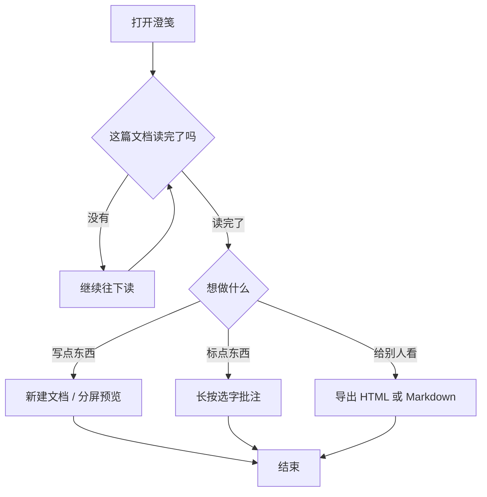
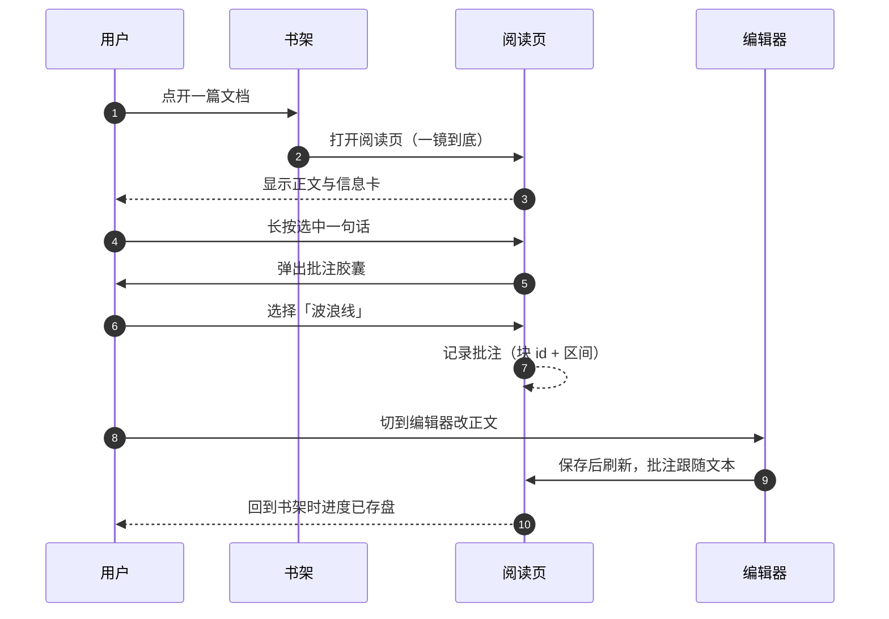
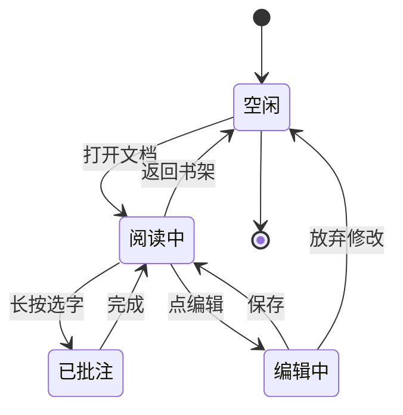
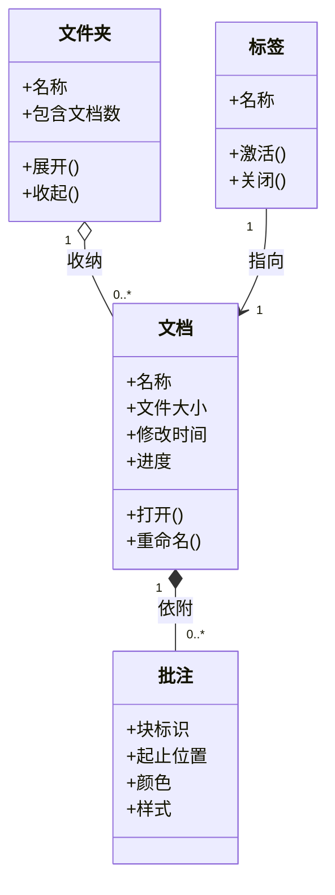
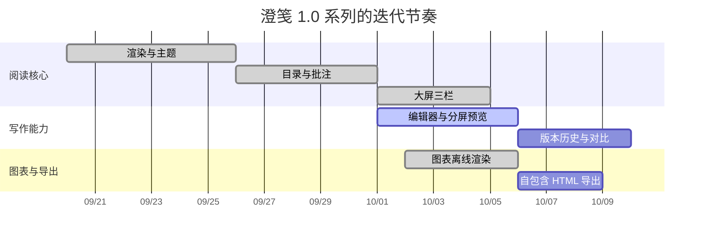
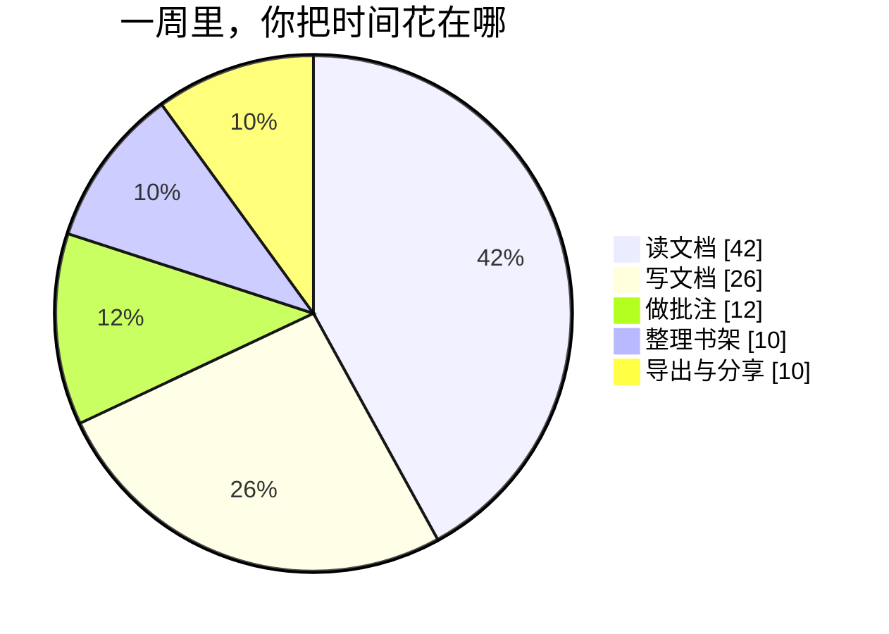
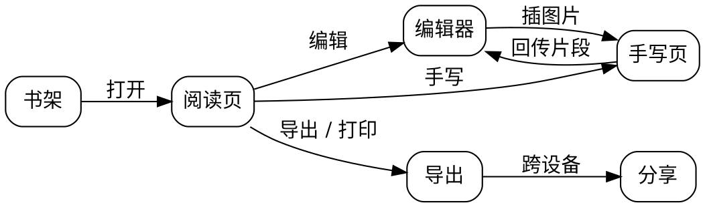
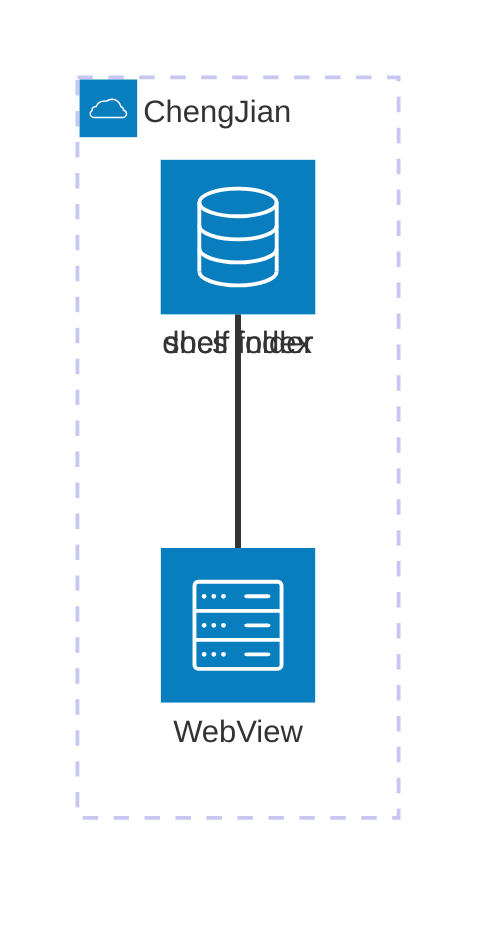
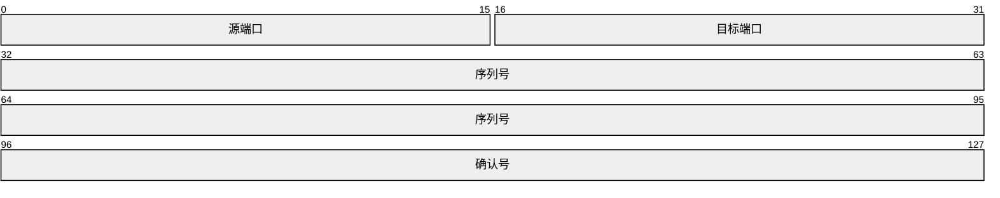

# 澄笺 · 全功能演示


> **澄笺（ChéngJiān）**，一款为 HarmonyOS 打造的沉浸式 Markdown 阅读与写作应用。
> 「澄」是澄澈透光，「笺」是文人纸笺 —— 我们把这两件事放在了一起：
> 玻璃质感的界面，与一张安静好写的纸。

这一篇不只是介绍文档，更是**渲染效果的验收样张**：从头读下去，你会依次看到排版、
批注、公式、十类图表、导出与手写。如果你看到每一节都正确显示，说明这台设备上的
渲染链路工作正常。

> [!TIP]
> 想边读边试？长按任意一段文字试试批注；或者点卡片右上角的「⋯」把这篇文档切成
> 「可写」，直接在上面改。

---

## 一、它是什么

一句话：**本地优先、不打扰、能装下复杂内容的 Markdown 工具。**

| 你关心的事 | 澄笺怎么做的 |
| --- | --- |
| 我的文件在哪 | 全部在本机应用目录里，不联网也能用（可用「基础模式」彻底断网） |
| 阅读体验 | 五档纸色主题、四档字号、可换字体、可调行距与栏宽 |
| 界面观感 | API 26 沉浸光感材质：卡片、按钮、顶栏底栏都是通透的玻璃 |
| 写东西 | 多标签、分屏实时预览、版本历史、查找替换、语法速查 |
| 标东西 | 长按选字做批注（荧光底 / 波浪线）、手写笔记、手写批注 |
| 复杂内容 | 公式、流程图、时序图、思维导图、统计图、乐谱，全部**离线**渲染 |
| 拿出去 | 导出 HTML（自包含单文件）/ Markdown，系统打印，跨设备分享 |

### 开源与致谢

**源码仓库**

- GitHub：[FengHDSL/LiteMdReader-HarmonyOS](https://github.com/FengHDSL/LiteMdReader-HarmonyOS)
- Gitee：[pandasoos/LiteMdReader-HarmonyOS](https://gitee.com/pandasoos/LiteMdReader-HarmonyOS)

**开源许可**：澄笺以 **MIT License** 开源 —— 可以自由地使用、修改、再分发；
唯一的要求是保留版权声明与许可文本，全文见仓库根目录的 `LICENSE` 文件。

**参考的项目**（仅参考思路，未复制其代码）

- [MrCashmere/miha_hm](https://github.com/MrCashmere/miha_hm)：沉浸光感承载层（Toggle + attributeModifier）方案
- [skadjhljhas/zhumo-reader](https://github.com/skadjhljhas/zhumo-reader)：注释卡片式的阅读形态
- [younghz/Markdown](https://github.com/younghz/Markdown)：《Markdown 语法教程》的语法口径与分类参考
- [Vditor](https://b3log.org/vditor/)：浏览器端 Markdown 编辑器（b3log / 88250 团队）；该团队的
  [链滴](https://ld246.com) 社区所著《Markdown 使用指南》系列是本文档第三节语法教程的分节与
  覆盖面参考（详见文末「参考与声明」）
- [luvi/lv-markdown-in](https://gitee.com/luvi/lv-markdown-in)：代码块行号 / 折叠 / 操作区、HTML 常用标签与 **font 快速样式**、懒渲染与预渲染块数的实现思路

**内置的渲染组件**（随应用打包、全部离线可用，各自遵循其原始开源许可，许可全文见各自仓库）：

| 组件 | 用途 |
| --- | --- |
| Mermaid（v11） | 流程图 / 时序图 / 状态图 / 类图 / 甘特图 / 饼图 / 看板 / 架构图 / 数据包图 |
| Apache ECharts | 柱状 / 折线等统计图 |
| Chart.js | 数据可视化（JSON 配置，四类入门示例见下） |
| Markmap | 思维导图 |
| Graphviz（viz.js） | 关系网络图 |
| flowchart.js | 流程图（另一套写法） |
| nomnoml | 极简 UML 类图 |
| KaTeX + mhchem | 数学公式与化学方程式 |
| abcjs | 五线谱（ABC 记谱） |
| Lute | Markdown 解析 |
| d3 / Raphael | 上述库的渲染依赖 |

### 它不太想做的事

- 不想让你注册账号：没有登录页，没有云端账号体系。
- 不想替你决定文件去哪：导入就是复制一份进应用，原文件不动。
- 不想在你读书时打扰你：网络链接**点击只复制地址**，不弹浏览器。

---

## 二、界面一览

### 书架

网格与列表两种形态，长按封面拖动可**合并成文件夹**；封面颜色由文件名哈希生成，
也能自己指定底色或换成图片。集齐的文档可以拖来拖去重新排序。

- [x] 继续阅读横幅（可在「外观设置」里关掉）
- [x] 长按拖动合并 / 收进文件夹
- [x] 全文搜索：文件名、正文、图片三组结果
- [x] 列表模式：树形的文件夹展开

### 阅读页

正文区之外，一切都可以收起来：

- 顶栏 / 底栏滚动时自动收起，上滑或回顶恢复；
- 左侧目录、右侧批注可停靠（大屏专属），列表里的批注可一键跳回原文；
- 标签栏可以放在顶部，也可以沉到底部胶囊里；
- 信息卡展示字数、行数、标题数、代码块数、文件大小、MD5 / SHA-256。

### 编辑器

| 能力 | 说明 |
| --- | --- |
| 多标签 | 同时开好几篇，标签名过长自动截断 |
| 分屏预览 | 左写右看，两侧滚动互相带 |
| 版本历史 | 定时快照 + 手动记录；支持左右**分屏对比**（新增行 / 删除行着色） |
| 查找替换 | 支持正则式的匹配计数、上一处 / 下一处、全部替换 |
| 语法速查 | 十八行语法，点一行插到光标位置，旁边就是真实渲染效果 |
| 手写 | 调起手写画布，写完插入正文或作为批注 |

---

## 三、Markdown 语法教程

> [!NOTE]
> 这一节**既是教程也是样张**：下面每一条示例都在这篇文档里真实渲染，看到的排版就是它自己的效果。
> 语法的分类与讲解顺序参考了链滴 Vanessa 的《Markdown 使用指南》系列（见文末**参考与声明**），
> 但内容**按澄笺的实际支持情况逐条重写**了 —— 标准写法很多，澄笺只实现了一部分，
> 不支持的会在 3.16 明确列出，免得你照着写完发现没反应。

### 3.1 标题

两种写法都认。ATX 用 `#` 的个数定层级（1~6 级），Setext 用下一行的 `===` / `---`：

```
# 一级标题        ←  本文档的大节用 ##，所以正文里你看不到 H1
## 二级标题         ←  就是「三、Markdown 语法教程」这一行
### 三级标题        ←  就是「3.1 标题」这一行
…… 一直到 ######  六级

Setext 一级标题
===============

Setext 二级标题
---------------
```

**最佳实践**：一篇文档只放一个 H1；别跳级（H2 下面直接 H4）—— 澄笺的目录面板按层级缩进，跳级会看起来错位。

### 3.2 段落与折行

空一行就是新段落。这是第一段。

这是第二段，中间隔了一个空行。

> [!WARNING]
> **澄笺没有"硬换行"**：段落内部的单次换行会被并成一个空格（上面这两段就是靠空行分开的）。
> 常见的"行尾加两个空格"或"行尾加 `\`"在澄笺里都不产生换行。要断行就空行分段，
> 或者改用列表、表格、引用。

### 3.3 强调与标记

**粗体**、*斜体*、***粗斜体***、~~删除线~~、==高亮==、`行内代码`、上标 x^2^、下标 H~2~O。

同一个词可以叠加：***又粗又斜***、**粗体里有 `代码` 和 ==高亮==**。

### 3.4 块引用与提示块

> 单层引用。
>
> > 嵌套一层，适合"引用里再引用"。
> >
> > > 还能更深，但手机上三层已经很挤了。

提示块是 GFM 风格，一共五类，颜色各不相同 —— NOTE 蓝、TIP 绿、IMPORTANT 紫、WARNING 黄、CAUTION 红：

> [!TIP]
> 提示块要在 `> [!类型]` 之后**换行**写正文，写在同一行不会被识别。

> [!CAUTION]
> 类型名不区分大小写，`> [!tip]` 和 `> [!TIP]` 一样；但必须是这五种之一，写错会退化成普通引用。

### 3.5 列表

无序列表的 `-` `*` `+` 三种标记等价（**建议统一用 `-`**，混用时源码不好读）：

- 第一项
- 第二项里可以有 **粗体**、`代码`、[链接](#3-5-列表) 和 ==高亮==
  - 缩进两格就是嵌套
  - 嵌套层里再来一层：
    - 第三层
    - 还是第三层
- 收尾项

有序列表按数字自增，中间换编号不打断顺序：

1. 第一步
2. 第二步
3. 第三步

列表项可以有**续行**：比标记缩进更深、又不算新块起始的行，会接进同一个列表项 ——

- 这是第一项的第一行，
  这是它的续行，两行都属于第一项。
- 第二项。

> [!WARNING]
> **列表项里嵌不了代码块和引用**。围栏、`>` 开头、标题、分隔线、脚注定义、另一个列表标记，
> 在澄笺里都算"新的块起始"，遇到它们当前列表就地断开，那些内容会作为**独立的块**显示在下面。
> 空一行同样会结束当前列表。想要"代码块紧跟在列表后面"，直接写在列表下面即可，只是它不属于那一项。

任务列表（GFM）：

- [x] 已完成：把这篇文档读完
- [ ] 待办：长按一段文字试试批注
- [ ] 待办：把标签栏切到底部看看

### 3.6 代码

行内代码用一对反引号包住：`npm run build`、`SELECT * FROM docs`。

> [!WARNING]
> 澄笺的行内代码**只认单对反引号**：内容里不能再出现反引号，标准里"外面用两个反引号来包住
> 含反引号的内容"这种写法在澄笺不生效（会被当成一对空代码块）。要写反引号本身，只能放进围栏代码块。

围栏代码块：单独一行写三个反引号起始，后面可以跟语言名以获得语法高亮；再以单独一行同样的标记结束。
另一种起始标记是三个波浪号。

```js
const greet = function (name) { return '你好，' + name; };
```

~~~python
def fib(n):
    return n if n < 2 else fib(n - 1) + fib(n - 2)
~~~

语言名写成 `mermaid` / `echarts` / `chart` / `markmap` / `graphviz` / `flowchart` / `nomnoml` / `abc` / `html`
时不再是"高亮代码"，而是**直接渲染成图表或可交互预览** —— 见第五节和第九节。

### 3.7 分隔线

下面这条就是 `---`（`***`、`___` 等价）：

---

### 3.8 超链接

三种写法（**这一节里的网址都是 `example.com` 占位域名**，专门留给文档示例用，
不是真实站点；本文档只有「开源与致谢」和文末「参考与声明」里放真链接）：

- 行内式：[带标题的链接](https://example.com "示例站点")（URL 后面空格加引号写标题，标题只在悬停/提示里出现）
- 引用式：正文写 [引用式链接][ref-1]，文末（任意位置）写定义 —— 适合同一个链接出现很多次
- 自动链接：裸写 https://example.com 就会自己变成链接

引用式定义长这样（上面那个"引用式链接"就是靠它生效的，点开是占位页）：

[ref-1]: https://example.com/guide "引用式链接的定义"

**不想让某个 URL 变成链接**？把它写成行内代码就不会自动识别：`https://example.com`。
（别指望反斜杠 —— 可转义字符集合里没有冒号，`https\://…` 会把那个反斜杠原样显示出来。）

**站内跳转**：`#` 后面写**目标标题的文字**，例如 [← 跳回 3.5 列表](#3-5-列表)。
匹配时会忽略空格、大小写和常见标点（`-` `_` `.` `/` `·` `。` `，` `、` `：` `:`），
所以 `#3.5 列表`、`#3-5-列表`、`#35列表` 都能命中同一个标题。找不到时会提示"找不到锚点"。

> [!WARNING]
> 澄笺**不认尖括号写法** `<https://example.com>` —— 那不是自动链接，会照原样显示字符。
> 另外站内锚点用的是"标题文字"，**不是** GitHub 那种 `#my-section-id` 片段。

### 3.9 图片

```

[](https://example.com)
```

链接套图片是合法的，整张图会变成可点的链接。图片的实际显示效果与点击放大见第二节。

### 3.10 转义字符

在符号前加反斜杠即可让它失去语法含义，澄笺认这一批：

```
\  `  *  _  {  }  [  ]  (  )  #  +  -  .  !  ~  =  |  >
```

例如想写出字面的 \*\*不是粗体\*\*，或者 1990\. 不想被当成有序列表。

### 3.11 表格

冒号控制列对齐：`:---` 左、`:---:` 中、`---:` 右。单元格里**可以写行内标记**：

| 能力 | 入口 | 说明 |
| --- | :---: | ---: |
| 全文搜索 | 书架顶栏 | 正文与文件名都搜 |
| 文档内查找 | 阅读页 | 命中**全部高亮** |
| 跳转行 | 编辑页 → 更多 | 输入行号直达 |
| 版本对比 | 编辑页 → 版本历史 | 左右分屏，支持 `==高亮==` |

表格过宽时内部横向滚动；点表格会打开可视化编辑器。

### 3.12 脚注

正文里放一个引用[^1]，另一处再来一个[^2]。

[^1]: 脚注定义写在文档任意位置（`[^标签]: 内容`），澄笺会把它们收集起来统一展示。
[^2]: 标签可以是中文，比如 `[^注]` 配 `[^注]: 内容`，只要两边一致。

### 3.13 Emoji

短代码 `:名字:` 会渲染成表情：:smile: :grin: :joy: :rofl:。
中文标点、emoji 直接打进正文也完全正常，不必都走短代码。

### 3.14 折叠块

块级的 `<details>` / `<summary>` 会被识别成可展开的折叠块（正文里的其他 HTML 标签不算）：

<details>
<summary>点我展开：一段不想常驻屏幕的补充说明</summary>

折叠起来的内容支持完整的行内标记 —— **粗体**、`代码`、列表都行。

- 比如这样一个列表项

</details>

### 3.15 正文里的 HTML

> [!IMPORTANT]
> **行内 HTML 标签不渲染**，会按纯文本显示（例如 `<b>粗</b>` 会原样看到尖括号）。
> 但把语言写成 `html` 的**围栏代码块**例外：它会渲染成可交互的预览卡片，`<script>` 照常执行
> —— 见第九节那个能用手指点着放的烟花。

### 3.16 澄笺不支持的写法

这一节原先列的「4 空格缩进代码块 / 尖括号自动链接 / 标题自定义 ID / 行内 HTML」**都已经支持了**，
留在"不支持"里会劝人不用写；现在只留真的没做的：

> [!CAUTION]
> - **硬换行**（行尾两空格 / 行尾 `\`）：段内换行会被并成空格，见 3.2
> - **行内脚注** `^[内容直接写在后面]`：脚注是 `[^标签]` + 文末定义两段式，见 3.13
> - **`+++` 分页**（pymdownx.tabbed 那套）：代码分组用 `::: code-group`，正文分组用提示块或折叠面板
> - **跨文件引用 / include**：澄笺是单文档模型，没有 `` 之类的机制
> - **Pandoc 的图表编号与文献引用**、**MDX 可交互组件**：效果见下面两段活例子

下面两段是**故意贴进正文给你看退化长什么样**的。它们不会报错，只会"照原样显示"，
看懂了就不会以为是自己写错了。

**Pandoc 专属：图表编号 + 文献引用**

{#fig:icon width=60%}

如图 @fig:icon 所示，Markdown 的语法设计受[@gruber2004]影响。

`{#fig:icon width=60%}` 这串花括号会被**吃掉**（pandoc 属性块词法：`#id` / `.类名` /
`key=value`，不再显示成正文噪音，见 3.17），但 `@fig:icon` 仍然不会变成"图 1"，
`[@gruber2004]` 的 `@` 被吃掉、只剩 `[gruber2004]` 当普通文字。原因不是解析器漏了：自动编号要
渲染器知道**全文所有图的出现顺序**再回头改写正文，文献引用要一份 `.bib`/CSL 数据源 ——
两件都在构建期做，而澄笺是"打开一个文件渲染一个文件"，离线也没有可查的文献库。
真要引用，眼下最合适的载体是脚注，文献表自己写在文末。

**MDX 可交互组件**

<Tabs>
  <TabItem value="js">JavaScript 内容</TabItem>
  <TabItem value="py">Python 内容</TabItem>
</Tabs>

上面这两个自定义标签**不会变成能点的页签**：`<Tabs>` / `<TabItem>` 走的是行内 HTML 那条
"脱标签、留内容"的路（见 3.15），所以你看到的只是两行正文。MDX 的前提是构建期把 JSX 编译成
组件、运行时有一个组件沙箱；这里两者都没有。
想要"能点的分组"，代码用 `::: code-group`（第九节），正文用 `<details>` 折叠面板。
（MDX 是什么可参考它的中文文档站 [mdx-cn](https://github.com/bbylw/mdx-cn)：MDX = 在 Markdown
里写 JSX，靠 `@mdx-js/mdx` 这类包在**构建期**把 JSX 编译成 React / Vue 组件——注意它是"编译工具链
+ 组件库"，不是一个能被阅读器直接渲染的格式。澄笺这一侧最接近的替代品是 `html` 语言围栏：
自己把结构与 `<script>` 写在一段 HTML 里，卡片与导出网页都会**真的执行**它。）

### 3.17 Pandoc 属性块与围栏 div

从 pandoc / MyST / VitePress 迁过来的文档常带这两种扩展写法。澄笺的原则是**能表达的表达、
不能表达的吃掉**，下面每一条都是本节渲染后的真实行为：

| 写法 | 渲染结果 |
| --- | --- |
| `## 背景 {#bg}`、`## 背景 {#bg .unnumbered}` | `#bg` 进锚点、整块括号不显示；`[背景](#bg)` 在应用里也跳得到 |
| `::: {#note1 .tip}` … `:::` | 提示卡，类名换色（`tip` / `info` / `warning` / `caution` / `important` / `danger`…），`#note1` 进锚点 |
| `::: {#d1 .details}` … `:::` | 折叠面板（与 `::: details` 同一条路） |
| `::: {=html}` … `:::` | 按 pandoc 的"原生块"语义当 HTML 渲染，脚本能跑，与 `html` 语言围栏同一条路 |
| `[重点]{.bold color=#2F63E8}` | 粗体 + 指定字色；`.italic` / `.strikeout` / `.underline`、`background-color=#RRGGBB` 同理 |
| `{#fig:a width=60%}` | 括号被吃掉（不再显示成噪音），但**不生成图号**，`@fig:a` 仍是普通文字 |

两条边界要说清楚：

1. **只有整块都像属性才算属性块**：花括号里每个词都必须是 `#id`、`.类名` 或 `key=value`。
   所以 `# 集合 { x }`、`这里有 { 三个词 }` 这种正常正文里的花括号**不会被误吞**。
2. **`key=value` 只是被吃掉，不是生效**：`width=60%`、`.unnumbered`、`style="…"` 这些
   澄笺没有对应的渲染能力（没有版式引擎、没有章节编号），吃掉是为了不让它污染正文，
   不代表图片真的被排成 60% 宽。

---

## 四、数学公式

公式由 **KaTeX** 排版，行内与块级四种写法都支持：`$…$`、`\(…\)`、`$$…$$`、`\[…\]`。
下面按类别给出**可直接复制走**的写法，全部是真实渲染结果（不是截图），逐条对照即可
判断某类语法是否受支持。

### 4.1 行内：混在句子里

质能方程 $E = mc^2$，勾股定理 $a^2 + b^2 = c^2$，圆面积 $S = \pi r^2$，欧拉恒等式
$e^{i\pi} + 1 = 0$，标准差 $\sigma = \sqrt{\frac{1}{N}\sum_{i=1}^{N}(x_i-\mu)^2}$。

> [!WARNING]
> 开头的 `$` 后面**不能紧跟空格**：`$ a+b $` 会被当成普通美元符号，要写 `$a+b$`。

### 4.2 希腊字母

$\alpha,\ \beta,\ \gamma,\ \theta,\ \lambda,\ \mu,\ \pi,\ \sigma,\ \phi,\ \omega$

$\Gamma,\ \Delta,\ \Theta,\ \Lambda,\ \Sigma,\ \Phi,\ \Omega$

### 4.3 上下标

普通上标 $x^2,\ e^{i\pi},\ a^{b^c}$；普通下标 $x_1,\ a_{ij},\ H_2O$；
同排上下标 $x_1^2,\ A_{ij}^{k}$。

### 4.4 分式与根式

行内有 $\frac{a}{b},\ \frac{n!}{k!},\ \tfrac{1}{2},\ \dfrac{x+1}{x-1}$，根式有
$\sqrt{x},\ \sqrt[3]{8},\ \sqrt[n]{x^2}$。嵌套分式单独成块更清楚：

$$
\frac{1}{1 + \frac{1}{1 + \frac{1}{x}}}
$$

### 4.5 运算符、关系与逻辑

$+,\ -, \times,\ \div,\ \pm,\ \mp,\ \cdot,\ \ast,\ \star,\ \circ$

$\oplus,\ \otimes,\ \odot,\ \bullet,\ \cap,\ \cup$

$=,\ \neq,\ <,\ >,\ \leq,\ \geq,\ \ll,\ \gg,\ \approx,\ \equiv,\ \propto,\ \sim$

$\forall,\ \exists,\ \neg,\ \wedge,\ \vee,\ \therefore,\ \because$

### 4.6 箭头

$\to,\ \rightarrow,\ \leftarrow,\ \uparrow,\ \downarrow,\ \mapsto,\ \longmapsto$

$\Rightarrow,\ \Leftarrow,\ \Leftrightarrow,\ \implies,\ \iff,\ \longrightarrow$

### 4.7 集合论

$\subset,\ \subseteq,\ \supset,\ \in,\ \notin,\ \setminus,\ \emptyset,\ \varnothing$

数集记号 $\mathbb{N},\ \mathbb{Z},\ \mathbb{Q},\ \mathbb{R},\ \mathbb{C}$，
描述法 $\{x \in \mathbb{R} \mid x^2 < 2\}$。

### 4.8 括号与定界符

自动缩放会跟着内容长：

$$
\left( \frac{a}{b} \right),\quad \left[ \frac{a}{b} \right],\quad \left\{ \frac{a}{b} \right\},\quad \left| \frac{a}{b} \right|,\quad \left\| \frac{a}{b} \right\|
$$

手动四档 $\big( x \big),\ \Big( x \Big),\ \bigg( x \bigg),\ \Bigg( x \Bigg)$，
嵌套也没问题 $\left( \left[ \left\{ \frac{a}{b} \right\} \right] \right)$。
取整与内积：$\lfloor x \rfloor,\ \lceil x \rceil,\ \langle u, v \rangle$。

### 4.9 矩阵与行列式

五种括号样式一次给全，外加可自定义对齐与分隔线的 `array`：

$$
\begin{pmatrix} 1 & 2 \\ 3 & 4 \end{pmatrix}
\qquad
\begin{bmatrix} a & b \\ c & d \end{bmatrix}
\qquad
\begin{Bmatrix} p & q \\ r & s \end{Bmatrix}
$$

$$
\begin{vmatrix} x & y \\ z & w \end{vmatrix} = xw - yz
\qquad
\begin{Vmatrix} a & b \\ c & d \end{Vmatrix}
$$

$$
\begin{array}{c|c}
a & b \\
\hline
c & d
\end{array}
\qquad
\begin{matrix} 1 & 0 \\ 0 & 1 \end{matrix}
$$

分块矩阵（矩阵套矩阵）：

$$
\begin{pmatrix}
\begin{matrix} 1 & 0 \\ 0 & 1 \end{matrix} & 0 \\
0 & \begin{matrix} 1 & 0 \\ 0 & 1 \end{matrix}
\end{pmatrix}
$$

矩阵乘向量：

$$
\begin{pmatrix} a & b \\ c & d \end{pmatrix}
\begin{pmatrix} x \\ y \end{pmatrix}
= \begin{pmatrix} ax + by \\ cx + dy \end{pmatrix}
$$

### 4.10 分段函数与多行对齐

$$
f(x) =
\begin{cases}
1, & x = 0 \\
\dfrac{\sin x}{x}, & x \neq 0
\end{cases}
$$

$$
\begin{aligned}
(a + b)^2 &= a^2 + 2ab + b^2 \\
(a - b)^2 &= a^2 - 2ab + b^2
\end{aligned}
$$

$$
\begin{aligned}
\sin x &= x - \frac{x^3}{3!} + \frac{x^5}{5!} - \cdots \\
&= \sum_{n=0}^{\infty} \frac{(-1)^n}{(2n+1)!}\,x^{2n+1}
\end{aligned}
$$

居中堆叠用 `gathered`，只在一侧加括号用 `\right.`：

$$
\begin{gathered}
a^2 + b^2 = c^2 \\
e^{i\pi} + 1 = 0
\end{gathered}
\qquad
\left\{ \begin{array}{ll} 1 & \text{if } x > 0 \\ 0 & \text{if } x \le 0 \end{array} \right.
$$

### 4.11 微积分

极限：

$$
\lim_{x \to 0} \frac{\sin x}{x} = 1
\qquad
\lim_{n \to \infty} \left(1 + \frac{1}{n}\right)^n = e
\qquad
\underset{x \to 0}{\lim} f(x)
$$

导数与偏导 $\frac{dy}{dx},\ f'(x),\ y'',\ \frac{\partial f}{\partial x},\ \frac{\partial^2 f}{\partial x \partial y}$，
梯度 $\nabla f = \left( \frac{\partial f}{\partial x}, \frac{\partial f}{\partial y} \right)$。
微积分基本定理：

$$
\frac{d}{dx}\left( \int_{a}^{x} f(t)\,dt \right) = f(x)
$$

四种积分：定积分 $\int_{a}^{b} f(x)\,dx$、二重 $\iint_{D} f(x,y)\,dx\,dy$、
三重 $\iiint_{V} f(x,y,z)\,dV$、曲线 $\oint_{\gamma} f\,ds$。高斯积分：

$$
\int_0^\infty e^{-x^2}\,dx = \frac{\sqrt{\pi}}{2}
$$

### 4.12 求和、乘积与组合数

$$
\sum_{i=1}^{n} i = \frac{n(n+1)}{2}, \qquad
\sum_{n=1}^{\infty} \frac{1}{n^2} = \frac{\pi^2}{6}
$$

$$
\prod_{k=1}^{n} k = n!
\qquad
\sum_{i=0}^{n} \binom{n}{i} = 2^n
\qquad
\binom{n}{k} = \frac{n!}{k!(n-k)!}
$$

### 4.13 装饰符号

上划线 $\overline{z},\ \overline{AB}$，下划线 $\underline{x}$；
帽子 $\hat{a},\ \widehat{ABC}$；波浪线 $\tilde{x},\ \widetilde{ABC}$；
向量 $\vec{v},\ \overrightarrow{AB}$；时间导数 $\dot{x},\ \ddot{x},\ \dddot{x}$；
上下标注 $\overset{\text{def}}{=}$，括号说明
$\underbrace{1 + 1 + \cdots + 1}_{n\ \text{个}} = n$，
$\overbrace{a + b + c}^{\text{三项}}$。

### 4.14 字体

空心体 $\mathbb{R},\ \mathbb{N},\ \mathbb{Z}$；花体 $\mathcal{F},\ \mathcal{L},\ \mathcal{O},\ \mathcal{P}$；
粗体 $\mathbf{A},\ \mathbf{v},\ \mathbf{x}_1$；粗体希腊字母
$\boldsymbol{\alpha},\ \boldsymbol{\beta},\ \boldsymbol{\theta}$；
正体（微分号与虚数单位）$\mathrm{d}x,\ \mathrm{e},\ \mathrm{i}$。

中文直接写进 `\text{}` 里就行：$\text{如果 } a = b \text{，则 } c = d$，
$\text{当 } x > 0 \text{ 时，} f(x) = x^2$。

### 4.15 框注、编号与颜色

$$
\boxed{E = mc^2}
\qquad
f(x) = x^2 \tag{1}
$$

$\color{red}{\text{红色}}\quad \color{blue}{\text{蓝色}}\quad \color{#2F63E8}{\text{十六进制}}$

### 4.16 自定义宏

`\newcommand` 在同一条公式内定义并使用（带参数用 `[1]`）：

$$
\newcommand{\vctr}[1]{\mathbf{#1}} \lvert \vctr{a} \rvert^2 = \vctr{a} \cdot \vctr{a}
$$

### 4.17 函数名与余波

$\gcd(a, b)\bmod m,\quad \log_2 n,\quad \ln x,\quad \arctan t,\quad \zeta(s) = \sum_{n=1}^{\infty} \frac{1}{n^s}$

> [!TIP]
> 公式太长时**单独成块**（`$$…$$`）比塞进行内更好看：块级公式居中、上下标会
> 展开成分式形式；行内公式为了不打断行高，会把分式压小。

---

## 五、十类图表：这才是重头戏

下面是澄笺支持的全部图表类型。每一节都给出**能直接复制走的最小示例**，以及
"渲染不出来"时最可能的原因。

> [!TIP]
> 所有图表都**离线渲染** —— 渲染库随应用打包，飞行模式下照常出图。
> 画好的图右上角有放大按钮：可缩放、双指捏合、**单指拖动**、还能旋转。

### 5.1 流程图（mermaid · graph）



要点与坑：

- 第一行的 `graph TD` 决定方向：`TD` 上到下、`LR` 左到右、`RL` 右到左、`BT` 下到上。
- `[]` 是矩形、`()` 是圆角、`{}` 是菱形、`(())` 是圆。
- 节点文字里出现括号、冒号等符号时，用引号包住：`A["说明（带括号）"]`。
- 箭头上的文字写 `-- 文字 -->`。

### 5.2 时序图（mermaid · sequenceDiagram）



要点与坑：

- 参与者用 `participant 别名 as 显示名` 起中文名；不写就用默认的 A、B。
- 实线箭头 `->>`、虚线 `-->>`；`autonumber` 会自动编号。
- 想加备注：`Note over U,R: 说明文字`。

### 5.3 状态图（mermaid · stateDiagram）



要点：`[*]` 是起点 / 终点；`A --> B: 事件` 冒号后是触发条件。

### 5.4 类图（mermaid · classDiagram）



要点：`+` 公开、`-` 私有；`o--` 聚合、`*--` 组合、`-->` 关联。

### 5.5 甘特图（mermaid · gantt）



要点与坑：

- `title` 写标题；`dateFormat` 必须与任务日期格式一致（这里都是 `YYYY-MM-DD`）。
- `done` / `active` 标出已完成与进行中；`after 任务名` 让任务接在前一个之后。
- **日期标签挤在一起**？跨度只有两三周时，刻度默认按天铺，`%m/%d` 就糊成一片。
  澄笺已把甘特图刻度固定为**一周一格**；若你的跨度更短（几天），把
  `axisFormat` 换成 `%d`（只显示日）就能进一步拉开。

### 5.6 饼图（mermaid · pie）



要点与坑：

- 第一行必须是 `pie`，`showData` 让扇区上直接显示数值。
- **标签必须用双引号包住**：`"读文档" : 42`。中文或含空格的标签不加引号会直接报
  `Lexical error`（整张图变成错误提示），这是饼图最常见的失败原因。
- 冒号两侧各留一个空格，数值不要带百分号（写了 `%` 会当成语法）。

### 5.7 统计图（echarts）

```echarts
{
  "title": { "text": "各文档阅读完成度", "left": "center" },
  "tooltip": { "trigger": "axis" },
  "legend": { "bottom": 0, "data": ["已读百分比"] },
  "grid": { "left": 40, "right": 20, "top": 50, "bottom": 40 },
  "xAxis": {
    "type": "category",
    "data": ["语法教程", "功能演示", "读书笔记", "会议记录"]
  },
  "yAxis": { "type": "value", "max": 100, "name": "%" },
  "series": [
    {
      "name": "已读百分比",
      "type": "bar",
      "barWidth": "46%",
      "itemStyle": { "borderRadius": [6, 6, 0, 0] },
      "data": [100, 86, 42, 15]
    }
  ]
}
```

折线 + 面积图同理，把 `"type": "bar"` 换成 `"line"`，并可用 `"areaStyle": {}` 填充。

> [!TIP]
> **坐标轴文字太长、挤成一片怎么办**？在对应轴的配置里加两行即可：
> ```json
> "axisLabel": { "rotate": 30, "interval": 0 }
> ```
> `rotate` 让标签倾斜排布，`interval: 0` 表示每个标签都显示（不自动跳档）。
> 类目名特别长时，再配 `"grid": { "bottom": 80 }` 给下方留出空间。
> 甘特图（mermaid）则用 `axisFormat` 控制日期格式，跨度大就用 `%m/%d`、跨度小用 `%d`。

> [!CAUTION]
> `echarts` 块里的内容**必须是合法 JSON**：不能有单引号、注释、尾随逗号。
> 图空白九成是 JSON 写错了 —— 贴到任意 JSON 校验工具过一遍最快。

### 5.8 思维导图（markmap）

```markmap
# 澄笺
## 阅读
### 五档纸色主题
### 目录 / 批注侧栏
### 标签多开
## 写作
### 分屏实时预览
### 版本历史与对比
### 查找替换
## 表达
### 公式与十类图表
### 手写笔记与手写批注
### 荧光底 / 波浪线批注
## 数据
### 本地优先，不联网可用
### 导出 HTML / Markdown
### 跨设备分享
```

要点：结构就是 **Markdown 大纲** —— `#` 是根节点、`##` 一级分支、`-` 也可以当节点。
**首行写的那个标题会成为根节点**。

### 5.9 关系网络图（graphviz）与乐谱（abc）

`graphviz` 用 DOT 语法画关系网：



`abc` 用 ABC 记谱法画**五线谱**（多声部也可以，下面这首是专为澄笺写的主题小曲）：

> [!NOTE]
> 这首《澄笺 · 主题》为**AI 为本文创作**的原创小曲（C 宫五声音阶，未参考任何现有作品），
> 若觉得好听可以随便用 —— MIT 同款待遇。

**钢琴谱（ABC 记谱 · 高低音双谱表）**

```abc
X:1
T:澄笺 · 主题（AI 创作）
C:Melody written by AI for ChengJian
M:4/4
L:1/8
Q:1/4=72
K:C
%%score { RH LH }
V:RH clef=treble name="Piano"
V:LH clef=bass name="Piano"
V:RH
C2 D2 E2 G2 | A2 G2 E2 D2 | E2 G2 A2 c2 | A4 z4 |
c2 A2 G2 E2 | G2 E2 D2 C2 | D2 E2 G2 A2 | G4 z4 |
V:LH
[C,E,G]4 [C,E,G]4 | [A,,C,E]4 [G,,C,D]4 | [C,E,G]4 [C,E,A]4 | [A,,C,E]4 [A,,C,E]4 |
[C,E,G]4 [C,E,A]4 | [C,E,G]4 [G,,C,D]4 | [A,,C,D]4 [C,E,G]4 | [C,E,G]4 [C,E,G]4 |
```

> [!TIP]
> ABC 里 `,` 表示低八度（`C,` = 低音 do）、`'` 表示高八度；`[C,E,G]` 是同时按下的和弦；
> 音符后的数字拉长时值（`G4` 是两个二分音符的长度，按 `L:1/8` 计）。

**没效果？**

- **语言名必须是 `abc`**（全小写）；拼错只会当代码块显示。
- **`X:1` 与 `K:C` 两行不能少**：没有调号行（`K:`）abcjs 不渲染。
- **多声部**：`V:名字` 声部 + `%%score { RH LH }` 声部编排，缺 `%score` 行会按顺序叠谱。
- **播放按钮没出现**：说明设备不支持 Web Audio（极少见），或 ABC 语法在解析时报错 ——
  先把内容简化到四小节试播，逐步加回来定位问题。

> [!NOTE]
> 还有第六个语言名 `flowchart`（flowchart.js 的老写法），澄笺也支持：
> 它以 `st=>start:` 开头、`e=>end:` 结尾，用 `->` 连接节点。
> 三种流程图写法（mermaid / flowchart / graphviz）任选一种顺手的即可。

### 5.10 数字波形（wavedrom）

写硬件、写协议文档要用到的**时序波形**，语言名 `wavedrom`，内容是 WaveJSON：

```wavedrom
{
  "signal": [
    { "name": "clk",  "wave": "p........" },
    { "name": "req",  "wave": "01..0..10" },
    { "name": "gnt",  "wave": "x.34x..2x", "data": ["读", "写", "中"] },
    ["总线",
      { "name": "addr", "wave": "x.3..4x", "data": ["A0", "A1"] },
      { "name": "data", "wave": "x..34.x", "data": ["D0", "D1"] }
    ]
  ],
  "head": { "text": "总线握手", "tick": 0 },
  "foot": { "text": "一个周期一格", "tocks": 8 }
}
```

同一套语法还能画**寄存器位段**（指令格式）与**逻辑门图**：

```wavedrom
{
  "reg": [
    { "name": "opcode", "bits": 8, "attr": "操作码" },
    { "name": "addr",   "bits": 16 },
    { "bits": 4, "attr": "保留" },
    { "bits": 4, "attr": "标志" }
  ],
  "config": { "bits": 32 }
}
```

逻辑门图一行写一个表达式，`=` 左边是结果、右边是输入：

```wavedrom
{
  "assign": [
    ["&", "A", "B", "=", "C"],
    ["|", "C", "D", "=", "F"],
    ["~", "F", "=", "Q"]
  ]
}
```

**没效果？**

- **必须是合法 JSON**。键名的引号可以省（`signal:` 会自动补成 `"signal":`），
  但**字符串值必须带引号** —— `wave:p....` 不行，要写 `"wave":"p...."`。
- 顶层要有 `signal`（波形）/ `reg`（位段）/ `assign`（逻辑门）三者之一。
- 深浅主题**都用浅色波形面板**：`signal` 的白底板由皮肤自带，`reg` / `assign`
  不画底板（位段框和文字是硬编码的黑描边黑字），澄笺会给它们补一块不透明白底，
  免得像"黑底写黑字"那样在深色卡片里糊掉。换官方 dark 皮肤反而更糟（同样是白底，
  描边却变浅色），所以固定用 default 皮肤，不需要配置。

### 5.10b Mermaid v11 新图种（看板 / 架构图 / 数据包图）

升级到 mermaid v11 后新增三种图。**看板**（kanban，任务列与卡片）：


**架构图**（architecture-beta，服务分组与连接）——
⚠️ **`[标签]` 只认不带点的 ASCII**：`[澄笺应用]` 与 `[shelf.json]` 都会报
`Parsing failed: unexpected character: ->[<-`（加引号也救不了），实测 `[docs folder]` 这种
带空格的英文没问题。分组名与服务名请写成 ASCII 单词，说明文字放正文：



**数据包图**（packet-beta，字节位段可视化）：



### 5.11 Chart.js 数据可视化（chart）

语言名 `chart`，内容是 **Chart.js 的 JSON 配置**，支持柱状 / 折线 / 饼图 / 环形 / 雷达等全部图种。
深色模式下会自动切换浅色文字；`options.width` / `options.height` 控制画布尺寸（默认 560×320）：

```chart
{
  "type": "bar",
  "data": {
    "labels": ["1 天", "3 天", "7 天", "半月", "一月"],
    "datasets": [
      { "label": "复习条数", "data": [12, 8, 5, 3, 2],
        "backgroundColor": "rgba(47, 99, 232, 0.65)" },
      { "label": "掌握条数", "data": [9, 7, 4, 2, 2],
        "backgroundColor": "rgba(31, 158, 102, 0.65)" }
    ]
  },
  "options": {
    "width": 560,
    "height": 300,
    "scales": { "y": { "beginAtZero": true } }
  }
}
```

折线图（`type: "line"`），`tension` 控制曲线圆滑程度：

```chart
{
  "type": "line",
  "data": {
    "labels": ["周一", "周二", "周三", "周四", "周五", "周六", "周日"],
    "datasets": [
      { "label": "写作字数", "data": [820, 932, 901, 1290, 1330, 1320, 1010],
        "borderColor": "#2F63E8", "backgroundColor": "rgba(47, 99, 232, 0.15)",
        "fill": true, "tension": 0.35 }
    ]
  },
  "options": { "width": 560, "height": 280 }
}
```

饼图（`type: "pie"`，环形用 `doughnut`）：

```chart
{
  "type": "pie",
  "data": {
    "labels": ["直接打开", "邮件营销", "联盟广告"],
    "datasets": [
      { "data": [335, 310, 234],
        "backgroundColor": ["#2F63E8", "#1F9E66", "#E08000"] }
    ]
  },
  "options": { "width": 420, "height": 300 }
}
```

> 注意：内容**必须是合法 JSON**（双引号、无注释、无尾随逗号）；`options.scales`
> 可以进一步定制坐标轴，`plugins.legend` 控制图例位置。
>
> 颜色写 **CSS 格式**（`#2F63E8`、`rgba(47,99,232,0.65)`），**不是**应用内部的
> `#AARRGGBB`：这里的字符串直接交给 Chart.js 填画布，`#FF2F63E8` 会被当成
> "红 255 绿 47 蓝 99、透明度 91%" 的**粉红**，而不是想要的蓝色。

### 5.12 nomnoml 极简 UML（nomnoml）

语言名 `nomnoml`，一行一个框，用 `[名称 | 字段 | 方法]` 描述类，箭头表示关系：

```nomnoml
[澄笺|MdParser; MdView; DocStore|渲染(); 批注(); 备份()]
[MdParser|- fence 识别|+ 解析正文]
[MdView|- 卡片排版|+ 增量刷新]
[DocStore|- shelf.json|+ 备份恢复]

[澄笺] -> [MdParser]
[澄笺] -> [MdView]
[澄笺] -> [DocStore]
[MdParser] => [MdView]
```

更复杂的关联修饰：`<` 继承、`+` 组合、`-` 依赖、`>` 指向：

```nomnoml
[学习者]
[学习卡|正面; 背面|拼写记忆()]
[复习计划|每日目标]
[学习者] -> [复习计划]
[复习计划] ++ [学习卡]
[学习卡] - [批注]
```

> nomnoml 语法极简但表达力有限，复杂 UML（泳道 / 时序）请用 mermaid。

### 5.12b Vega-Lite 声明式统计图（vega-lite）

语言名 `vega-lite`（别名 `vl` / `vega`），内容是 **Vega-Lite 的 JSON spec**：
`data` 给数据、`mark` 给图形类型、`encoding` 说哪个字段映射到什么通道。
引擎是随包的 Vega 6.4.0 + Vega-Lite 6.5.0（BSD-3-Clause），出的是**矢量 SVG**，
放大浮层里捏合不会糊：

```vega-lite
{
  "data": { "values": [
    { "平台": "鸿蒙", "篇数": 42 },
    { "平台": "Web", "篇数": 88 },
    { "平台": "iOS", "篇数": 31 }
  ] },
  "mark": { "type": "bar", "cornerRadiusEnd": 4 },
  "encoding": {
    "x": { "field": "平台", "type": "nominal" },
    "y": { "field": "篇数", "type": "quantitative" },
    "color": { "field": "平台", "type": "nominal" }
  },
  "width": 320,
  "height": 200
}
```

聚合与折线也一样写（`aggregate` 直接挂在通道上）：

```vl
{
  "data": { "values": [
    { "周": 1, "字数": 820 }, { "周": 2, "字数": 932 },
    { "周": 3, "字数": 901 }, { "周": 4, "字数": 1290 }
  ] },
  "layer": [
    { "mark": { "type": "line", "point": true } },
    { "mark": { "type": "rule", "color": "firebrick", "strokeDash": [4, 4] },
      "encoding": { "y": { "aggregate": "mean", "field": "字数" } } }
  ],
  "encoding": {
    "x": { "field": "周", "type": "ordinal" },
    "y": { "field": "字数", "type": "quantitative" }
  },
  "width": 320,
  "height": 200
}
```

三条边界说清楚：

1. **内容必须是合法 JSON**（双引号、无注释、无尾随逗号），与 `chart` / `echarts` 同一口径。
2. `width` / `height` 不写时按卡片宽度出图；写了就尊重作者的，但**超过卡宽会等比缩**，
   不会把正文横向撑破。
3. 深色卡片下只兜底色与文字颜色（轴标签、图例、网格线跟着翻），
   **作者自己写过的 `config` 一律不覆盖** —— 自定义配色不会被引擎冲掉。
   纯 Vega 语法（`"mark": {"type": ...}` 那套底层写法）也支持，但推荐用 Lite。

### 5.13 化学方程式（mhchem）

数学公式引擎挂载了 **mhchem 扩展**，`\ce{}` 命令直接写化学式，自动处理
下标、配平系数、气体沉淀箭头：

$$
\ce{CO2 + C -> 2 CO}
$$

$$
\ce{2H2 + O2 ->[点燃] 2H2O}
$$

可逆与沉淀：

$$
\ce{CaCO3 + 2HCl = CaCl2 + H2O + CO2 ^}
$$

> 行内也可以用：水的电离 $\ce{H2O <=> H+ + OH-}$ 是可逆反应。

### 5.14 图表速查

| 语言名 | 首行怎么写 | 最容易踩的坑 |
| --- | --- | --- |
| `mermaid` | `graph TD` / `sequenceDiagram` / `stateDiagram-v2` / `classDiagram` / `gantt` / `pie` | 语言名必须全小写；一张图一个代码块 |
| `zenuml` | 写在 ` ```mermaid ` 里，首行 `zenuml`，然后 `@Actor User` / `User->App.open()` | 澄笺带了这个插件，直接画；深色卡片里仍是白底面板（插件自己的配色） |
| `echarts` | 直接写 JSON 的 `{` | 必须是合法 JSON |
| `markmap` | `# 根节点` | 根节点就是第一行标题 |
| `graphviz` | `digraph 名字 {` | 别忘了最外层大括号 |
| `flowchart` | `st=>start: 开始` | 末尾要有 `e=>end:` |
| `abc` | `X:1` | `K:` 调号行不能少 |
| `wavedrom` | `{` 开头的 WaveJSON | 值必须带引号；顶层要有 signal / reg / assign |
| `chart` | `{` 开头的 Chart.js 配置 | 颜色写 **CSS 格式**（`#2F63E8`），不是应用内部的 `#AARRGGBB` |
| `nomnoml` | `[框 \| 字段 \| 方法]` | 复杂 UML（泳道 / 时序）改用 mermaid |
| `vega-lite` | `{` 开头的 spec，含 `data` / `mark` / `encoding` | 必须合法 JSON；`width` / `height` 不写就按卡宽出图 |
| `plantuml` | `@startuml` / `@startmindmap` / `@startwbs` / `@startgantt` / `@startjson` / `@startyaml` | 官方内核离线渲染；`@startsalt`、`@startnwdiag`、`@startditaa` 只显示源码，`@startmath` 转公式，`@starttimeline` 转 mermaid（详见《渲染能力矩阵》） |

---

## 六、批注与手写

### 批注

阅读时长按选中文字，会弹出一枚可拖动的胶囊：

- **荧光底**：整段变成浅色底纹，适合划重点；
- **波浪线**：文字下方一条波浪，适合标"这里要再看一遍"；
- 颜色四选：红 / 绿 / 蓝 / 黄；
- 右侧批注抽屉按文档汇总，点一条可跳回原文位置。

批注是**跟着文本走**的：坐标系记的是「块 id + 渲染文本区间」，
所以你在编辑器里改了别处、批注仍会贴在原来那句话上。

### 批注公式

公式渲染出来是一张图，**没有文字选区**，所以长按选字那条路对公式无效。
改用这两个入口，打开的是同一个批注面板，只是会**把公式渲染出来**：

- **行内公式**（段落里的 `$…$`）：点它 → 菜单里选「批注」（这个菜单本身也会先把公式渲染出来，源码放下面当对照）；
- **块级公式卡片**（`$$…$$`）：卡片顶部「公式」栏右边那排按钮里**最左那个**（在放大按钮左边）。

面板里有四样东西：

| 位置 | 作用 |
| --- | --- |
| 渲染预览 | 显示**将要被批注的那一段**（选中对得上就渲染选中段，否则整条） |
| 源码框 | 这条公式的 LaTeX，可以选、可以改 |
| 「保存公式」 | 把改过的源码写回文档原位（块级保留原有 `$$` / `\[…\]` 与单行多行形态） |
| 「普通批注 / 学习卡」 | 选这条批注的形态：普通批注只加底纹，学习卡进背诵系统（书架「文房」复习） |

不管是文字批注还是公式批注，**开始打字时面板会平滑地抬到输入法上方**（约 0.2 秒的过渡，
键盘收起再平滑落回），输入框不会被键盘盖住。输入框还会**随你写的行数继续长高**，
长到"键盘之外那块可视高度"的上限后改为框内滚动 —— 所以键盘弹起时它不会把面板顶出屏幕，
键盘收起后还能继续长。所有半模态面板（批注、重命名、新建文档、导出、阅读设置……）顶部那根
**拖拽条都能往上拉**，逐档变高（贴合内容 → 60% → 大屏），松手吸附；往下拖回原档。
横屏与平板居中窗口按系统限制不提供多档拖拽，面板维持贴合内容的高度。

**只批注公式里的一小段**：在源码框里长按选中那一段（比如只选 `\frac{a}{b}`），
再点「保存批注」——存下来的区间就是这一小段，批注抽屉里也只渲染它。
正文里的底纹仍然铺在整条公式上（图切不开，切开的半截 LaTeX 渲染不出来）。

> [!NOTE]
> 选中必须是**文档里已有的内容**才生效：改了源码但还没点「保存公式」时，
> 草稿的字符位置和正文已经对不上，这时保存批注会退回整条（标题会提示你）。

### 手写

从编辑页或阅读页进入手写画布（华为手写笔套件 Pen Kit）：

- 画布背景可换：12 款淡色底 + 「主题色」动态跟随 + 五款壁纸同色底；
- 底纹四选：无 / 小方格 / 单行线 / 点阵，线条粗细三档；
- 写完点「插入」——手写图会带着**你选的底色与底纹**一起插进正文；
- 批注模式下写完，会落成一条带手写图的双下划线批注。

> [!IMPORTANT]
> 手写图的底色与底纹是**烘焙进图片**的，所以插入正文后在任何主题下都不会糊掉。

---

## 七、数据在自己手里

| 动作 | 入口 | 说明 |
| --- | --- | --- |
| 导出单篇 | 卡片「⋯」→ 导出 / 分享 | HTML（自包含）或 Markdown |
| 打印 | 导出面板 → 打印 | 走系统打印，真实分页 |
| 整库备份 | 设置 → 数据管理 | 打包成 zip，含图片与设置 |
| 图片管理 | 设置 → 数据管理 → 图片管理 | 集中查看、导出、移除 |
| 跨设备分享 | 阅读页碰一碰 / 隔空传送 | HarmonyOS 设备间直传 |

> [!NOTE]
> 全量模式下可开启网络备份与检查更新；**基础模式**彻底不联网，
> 网络图片不加载、网络功能不可用，本地功能一切照常。

---

## 八、这篇文档怎么用

1. 把它当**样张**：从头翻一遍，确认图表、公式、表格都正常显示。
2. 把它当**模板**：切到「可写」，删掉不需要的章节，留下你要的结构。
3. 把它当**速查**：上面的图表速查表可以直接复制到你的新文档里改。
4. 更细的语法规则（含"没效果"的排查）见另一篇内置文档《Markdown 语法教程》。

想深入哪一种图表，就去「更多 → 语法」面板里找那一行 —— 点一下，示例会直接插进你的正文。

---

*澄笺 · 安静地读，顺手地写。*

---

## 九、代码块与 HTML 预览

### 代码块：行号 + 长代码折叠

代码块**默认显示行号**；超过 **10 行**的代码块会自动折叠，点下方的「展开全部 N 行」看完整内容
（再点「收起代码」收回去）。

```js
// 这段超过 10 行，在阅读页里默认是折叠状态
function fib(n) {
  if (n <= 1) {
    return n;
  }
  let a = 0;
  let b = 1;
  for (let i = 2; i <= n; i++) {
    const t = a + b;
    a = b;
    b = t;
  }
  return b;
}
```

下面三段都是**超过 10 行**的长代码，用来验证折叠与行号（点「展开全部」看全文）：

**Python**

```python
def quicksort(arr):
    """快速排序：小数组直接插入排序，避免递归开销。"""
    if len(arr) <= 1:
        return arr
    pivot = arr[len(arr) // 2]
    left = [x for x in arr if x < pivot]
    mid = [x for x in arr if x == pivot]
    right = [x for x in arr if x > pivot]
    return quicksort(left) + mid + quicksort(right)

if __name__ == '__main__':
    data = [3, 6, 1, 8, 2, 9, 4]
    print(quicksort(data))
```

**C**

```c
#include <stdio.h>
#include <string.h>

#define BUF_SIZE 256

int main(void) {
    char buf[BUF_SIZE];
    int words = 0;
    printf("请输入一行文字：");
    if (fgets(buf, BUF_SIZE, stdin) == NULL) {
        return 1;
    }
    for (int i = 0; buf[i] != '\0'; i++) {
        if (buf[i] == ' ' || buf[i] == '\n') {
            words++;
        }
    }
    printf("大约 %d 个单词\n", words);
    return 0;
}
```

**Java**

```java
import java.util.HashMap;
import java.util.Map;

public class WordCount {
    /** 统计每个字符出现的次数，按插入顺序输出。 */
    public static Map<Character, Integer> count(String text) {
        Map<Character, Integer> map = new HashMap<>();
        for (char c : text.toCharArray()) {
            if (Character.isWhitespace(c)) {
                continue;
            }
            map.put(c, map.getOrDefault(c, 0) + 1);
        }
        return map;
    }

    public static void main(String[] args) {
        for (Map.Entry<Character, Integer> e : count("澄心执笔 笺上生光").entrySet()) {
            System.out.println(e.getKey() + " -> " + e.getValue());
        }
    }
}
```

### 支持高亮的常用语言（一览）

语言名写在起始围栏的后面（三个反引号或三个波浪号紧跟语言名，例如波浪号写法 `~~~python`），
它决定左上角的**语言徽标**与**语法高亮**。下面每种给一个短例子，方便对照：

**Python**
```python
from dataclasses import dataclass


@dataclass
class Doc:
    name: str
    words: int
    starred: bool = False


def summary(docs):
    total = sum(d.words for d in docs)
    starred = sum(1 for d in docs if d.starred)
    return f"共 {len(docs)} 篇 · {total} 字 · 星标 {starred}"


docs = [Doc("读书笔记", 1200, True), Doc("周报", 800)]
print(summary(docs))
```

**JavaScript**
```js
// 文档集合的简单统计
const docs = [
  { name: '读书笔记', words: 1200, starred: true },
  { name: '周报', words: 800, starred: false },
  { name: '会议记录', words: 640, starred: true },
];

const totalWords = (xs) => xs.reduce((sum, d) => sum + d.words, 0);
const starredCount = (xs) => xs.filter((d) => d.starred).length;

console.log(`共 ${docs.length} 篇`);
console.log(`总字数 ${totalWords(docs)}`);
console.log(`星标 ${starredCount(docs)} 篇`);
```

**TypeScript**
```ts
interface Doc {
  name: string;
  words: number;
  starred?: boolean;
}

function summary(docs: Doc[]): string {
  const total = docs.reduce((sum, d) => sum + d.words, 0);
  const starred = docs.filter((d) => d.starred).length;
  return `共 ${docs.length} 篇 · ${total} 字 · 星标 ${starred}`;
}

const docs: Doc[] = [
  { name: '读书笔记', words: 1200, starred: true },
  { name: '周报', words: 800 },
];

console.log(summary(docs));
```

**Java**
```java
import java.util.List;

public class Main {
    record Doc(String name, int words, boolean starred) {}

    public static void main(String[] args) {
        List<Doc> docs = List.of(
            new Doc("读书笔记", 1200, true),
            new Doc("周报", 800, false)
        );
        int total = docs.stream().mapToInt(Doc::words).sum();
        System.out.println("共 " + docs.size() + " 篇 · " + total + " 字");
        docs.forEach(d -> System.out.println(d.name()));
    }
}
```

**C**
```c
#include <stdio.h>
#include <string.h>

typedef struct {
    char name[32];
    int words;
} Doc;

int main(void) {
    Doc docs[2] = {
        {"读书笔记", 1200},
        {"周报", 800}
    };
    int total = 0;
    for (int i = 0; i < 2; i++) {
        total += docs[i].words;
        printf("%s · %d 字\n", docs[i].name, docs[i].words);
    }
    printf("合计 %d 字\n", total);
    printf("长度校验 %zu\n", strlen(docs[0].name));
    return 0;
}
```

**C++**
```cpp
#include <iostream>
#include <string>
#include <vector>

struct Doc {
    std::string name;
    int words;
};

int main() {
    std::vector<Doc> docs = {
        {"读书笔记", 1200},
        {"周报", 800}
    };
    int total = 0;
    for (const auto& d : docs) {
        std::cout << d.name << " · " << d.words << " 字" << std::endl;
        total += d.words;
    }
    std::cout << "合计 " << total << " 字" << std::endl;
    return 0;
}
```

**C#**
```cs
using System;
using System.Collections.Generic;
using System.Linq;

class Doc
{
    public string Name { get; set; }
    public int Words { get; set; }
}

class Program
{
    static void Main()
    {
        var docs = new List<Doc>
        {
            new Doc { Name = "读书笔记", Words = 1200 },
            new Doc { Name = "周报", Words = 800 }
        };
        Console.WriteLine($"共 {docs.Count} 篇 · {docs.Sum(d => d.Words)} 字");
    }
}
```

**Go**
```go
package main

import "fmt"

type Doc struct {
	Name    string
	Words   int
	Starred bool
}

func main() {
	docs := []Doc{
		{"读书笔记", 1200, true},
		{"周报", 800, false},
	}
	total := 0
	for _, d := range docs {
		total += d.Words
		fmt.Printf("%s · %d 字\n", d.Name, d.Words)
	}
	fmt.Println("合计", total, "字")
}
```

**Rust**
```rust
struct Doc {
    name: String,
    words: u32,
    starred: bool,
}

fn summary(docs: &[Doc]) -> String {
    let total: u32 = docs.iter().map(|d| d.words).sum();
    let starred = docs.iter().filter(|d| d.starred).count();
    format!("共 {} 篇 · {} 字 · 星标 {}", docs.len(), total, starred)
}

fn main() {
    let docs = vec![
        Doc { name: "读书笔记".into(), words: 1200, starred: true },
        Doc { name: "周报".into(), words: 800, starred: false },
    ];
    println!("{}", summary(&docs));
}
```

**Swift**
```swift
struct Doc {
    let name: String
    var words: Int
    var starred: Bool
}

func summary(_ docs: [Doc]) -> String {
    let total = docs.reduce(0) { $0 + $1.words }
    let starred = docs.filter { $0.starred }.count
    return "共 \(docs.count) 篇 · \(total) 字 · 星标 \(starred)"
}

let docs = [
    Doc(name: "读书笔记", words: 1200, starred: true),
    Doc(name: "周报", words: 800, starred: false)
]
print(summary(docs))
```

**Kotlin**
```kotlin
data class Doc(val name: String, val words: Int, val starred: Boolean = false)

fun summary(docs: List<Doc>): String {
    val total = docs.sumOf { it.words }
    val starred = docs.count { it.starred }
    return "共 ${docs.size} 篇 · $total 字 · 星标 $starred"
}

fun main() {
    val docs = listOf(
        Doc("读书笔记", 1200, true),
        Doc("周报", 800)
    )
    println(summary(docs))
    docs.forEach { println("· ${it.name}") }
}
```

**Shell**
```sh
#!/bin/sh
# 统计目录下所有 Markdown 的字数（示意）
total=0
count=0
for f in *.md; do
  words=$(wc -m < "$f")
  echo "$f · $words 字"
  total=$((total + words))
  count=$((count + 1))
done
echo "共 $count 篇 · $total 字"
if [ "$total" -gt 10000 ]; then
  echo "产出很稳定，继续保持"
fi
```

**SQL**
```sql
SELECT
    d.name    AS 文档名,
    d.words   AS 字数,
    f.name    AS 所在文件夹,
    d.starred AS 是否星标
FROM docs AS d
LEFT JOIN folders AS f ON f.id = d.folder_id
WHERE d.words > 500
ORDER BY d.words DESC, d.name ASC
LIMIT 10;

-- 星标文档的字数合计
SELECT SUM(words) FROM docs WHERE starred = 1;
```

**JSON**
```json
{
  "app": "澄笺",
  "version": "1.0.8",
  "docs": [
    { "name": "读书笔记", "words": 1200, "starred": true },
    { "name": "周报", "words": 800, "starred": false }
  ],
  "settings": {
    "fontSize": 18,
    "lineHeight": 1.75,
    "theme": "纸色"
  },
  "features": ["表格编辑", "对照阅读", "多设备流转"]
}
```

**YAML**
```yaml
app: 澄笺
version: 1.0.8
settings:
  fontSize: 18
  lineHeight: 1.75
  themeMode: 跟随系统
docs:
  - name: 读书笔记
    words: 1200
    starred: true
  - name: 周报
    words: 800
    starred: false
features:
  - 表格编辑
  - 对照阅读
```

**HTML / CSS** —— 注意：`html` 围栏会**渲染成预览**，想展示源码请用 `markdown` 或 `text`
```markdown
# 一份 HTML 样式示例

<div class="card">
  <p>一段 <b>HTML</b> 也可以直接写在围栏里。</p>
  <p>想看渲染效果：把语言名改成 <code>html</code>（见下一节）。</p>
</div>
```

```css
.card {
  max-width: 640px;
  margin: 16px auto;
  padding: 16px 20px;
  border-radius: 16px;
  background: #ffffff;
  box-shadow: 0 2px 12px rgba(18, 50, 79, 0.08);
  font-family: HarmonyOS Sans, system-ui, sans-serif;
  color: #2a3f5f;
  line-height: 1.7;
}

.card b {
  color: #1f8a70;
}
```

### HTML 快速样式与预览

把代码块的语言写成 `html`，它会**直接渲染成预览**（不显示源码），于是 `<font>` 这类
**快速样式**与常见标签都能立刻看到效果：

```html
<style>
  .fx {
    font-family: HarmonyOS Sans, system-ui, sans-serif;
    padding: 12px 14px 14px; border-radius: 16px; user-select: none;
    background: radial-gradient(120% 90% at 50% 0%, #1B2340 0%, #0B0E1D 62%, #06070F 100%);
    border: 1px solid rgba(150,180,255,0.16);
    box-shadow: 0 10px 30px rgba(6,8,18,0.55);
  }
  .fx .hud {
    display: flex; justify-content: space-between; align-items: baseline;
    font-size: 12.5px; color: #9FB2DC; margin-bottom: 8px;
    font-variant-numeric: tabular-nums; letter-spacing: .02em;
  }
  .fx .hud .t { color:#EAF0FF; font-size:13.5px; text-shadow:0 0 12px rgba(120,180,255,.55); }
  .fx .hud b { color:#fff; }
  .fx .combo { margin-left:8px; color:#FFD37A; text-shadow:0 0 10px rgba(255,190,80,.55); }
  .fx .shape { margin-left:8px; color:#8FE3C8; text-shadow:0 0 10px rgba(120,230,190,.5); }
  /* 画布按容器宽自适应；位图尺寸由 JS 按 devicePixelRatio 对齐，不会拉伸 */
  .fx canvas {
    display:block; width:100%; aspect-ratio:4/3; min-height:150px;
    border-radius:12px; background:#070A16; touch-action:none;
  }
  .fx .tip { margin-top:8px; font-size:11.5px; color:#7286B4; text-align:center; }
</style>
<div class="fx" id="fxRoot">
  <div class="hud">
    <span class="t">✦ 指尖烟花</span>
    <span>发射 <b id="fxShots">0</b> · 粒子 <b id="fxParts">0</b><span class="shape" id="fxShape"></span><span class="combo" id="fxCombo"></span></span>
  </div>
  <canvas id="fxCanvas"></canvas>
  <div class="tip">点一下炸一朵（爱心 / 星星 / 笑脸 / 菊花…）· 按住拖动拉出光带 · 连点触发二次连爆 · 停手 3 秒自动表演</div>
</div>
<script>
(function () {
  var cv = document.getElementById('fxCanvas');
  if (!cv || cv.__fx) { return; }
  cv.__fx = true;
  var ctx = cv.getContext('2d');
  var elShots = document.getElementById('fxShots');
  var elParts = document.getElementById('fxParts');
  var elCombo = document.getElementById('fxCombo');
  var elShape = document.getElementById('fxShape');

  var W = 320, H = 240, u = 1, dpr = 1;
  var parts = [], rock = [], trail = [], stars = [], fuse = [], flashes = [];
  var shots = 0, combo = 0, comboT = 0, lastTouch = 0, frame = 0, hueSeed = Math.random() * 360;
  var MAX = 700, GRAV = 0.055;
  // 圆壳类 + 造型类（造型用高阻尼"停"在轮廓上，才看得清形状）+ 二次起爆类
  var KINDS = ['peony', 'ring', 'willow', 'chrys', 'palm', 'crackle',
    'star', 'heart', 'smiley', 'diamond', 'crossette', 'double'];
  var CN = {
    peony: '牡丹', ring: '圆环', willow: '垂柳', chrys: '菊花', palm: '棕榈', crackle: '碎金',
    star: '五角星', heart: '爱心', smiley: '笑脸', diamond: '菱形', crossette: '二次爆', double: '双响'
  };
  var SHAPE_KIND = { star: 1, heart: 1, smiley: 1, diamond: 1 };

  function fit() {
    var cw = cv.clientWidth || 320, ch = cv.clientHeight || Math.round(cw * 3 / 4);
    dpr = Math.min(2.5, Math.max(1, window.devicePixelRatio || 1));
    cv.width = Math.round(cw * dpr); cv.height = Math.round(ch * dpr);
    ctx.setTransform(dpr, 0, 0, dpr, 0, 0);
    W = cw; H = ch; u = Math.max(0.7, H / 240);
    stars = [];
    for (var i = 0; i < 78; i++) {
      stars.push({ x: Math.random() * W, y: Math.random() * H * 0.94, r: Math.random() * 1.4 * u + 0.4, p: Math.random() * 6.3 });
    }
  }

  function push(p) { if (parts.length < MAX) { parts.push(p); } }
  function flash(x, y, hue, a) { flashes.push({ x: x, y: y, hue: hue, life: 12, a: a || 1 }); }

  // 沿多边形周长均匀取 n 个点（五角星 / 菱形用）
  function walkPoly(v, n) {
    var seg = [], total = 0, i, j, a, b, d;
    for (i = 0; i < v.length; i++) {
      a = v[i]; b = v[(i + 1) % v.length];
      d = Math.sqrt((b[0] - a[0]) * (b[0] - a[0]) + (b[1] - a[1]) * (b[1] - a[1]));
      seg.push(d); total += d;
    }
    var out = [], step = total / n, acc = 0, si = 0, sl = 0;
    for (j = 0; j < n; j++) {
      var want = step * j;
      while (si < seg.length - 1 && want > acc + seg[si]) { acc += seg[si]; si++; }
      var t = seg[si] > 0 ? (want - acc) / seg[si] : 0;
      a = v[si]; b = v[(si + 1) % v.length];
      out.push([a[0] + (b[0] - a[0]) * t, a[1] + (b[1] - a[1]) * t]);
    }
    return out;
  }

  // 造型轮廓上的单位方向（长度即相对速度）
  function shapePts(kind, n) {
    var out = [], i, a, t, m;
    if (kind === 'star') {
      var v = [];
      for (i = 0; i < 10; i++) {
        a = Math.PI / 5 * i - Math.PI / 2;
        var r = (i % 2 === 0) ? 1 : 0.42;
        v.push([Math.cos(a) * r, Math.sin(a) * r]);
      }
      return walkPoly(v, n);
    }
    if (kind === 'diamond') { return walkPoly([[0, -1], [0.6, 0], [0, 1], [-0.6, 0]], n); }
    if (kind === 'heart') {
      for (i = 0; i < n; i++) {
        t = Math.PI * 2 * i / n;
        var hx = 16 * Math.pow(Math.sin(t), 3);
        var hy = 13 * Math.cos(t) - 5 * Math.cos(2 * t) - 2 * Math.cos(3 * t) - Math.cos(4 * t);
        out.push([hx / 15, -hy / 15]);
      }
      return out;
    }
    if (kind === 'smiley') {
      m = Math.floor(n * 0.55);
      for (i = 0; i < m; i++) { a = Math.PI * 2 * i / m; out.push([Math.cos(a), Math.sin(a)]); }
      var eyes = [[-0.38, -0.3], [0.38, -0.3]], e, k, mm = Math.floor(n * 0.08);
      for (e = 0; e < 2; e++) {
        for (k = 0; k < mm; k++) {
          a = Math.PI * 2 * k / mm;
          out.push([eyes[e][0] + Math.cos(a) * 0.13, eyes[e][1] + Math.sin(a) * 0.18]);
        }
      }
      m = Math.floor(n * 0.22);
      for (i = 0; i < m; i++) {
        a = Math.PI * (0.18 + 0.64 * i / m);
        out.push([Math.cos(a) * 0.62, 0.2 + Math.sin(a) * 0.42]);
      }
      return out;
    }
    return out;
  }

  function shell(x, y, hue, kind, n) {
    var i, a, sp, life, p;
    if (SHAPE_KIND[kind]) {
      var pts = shapePts(kind, n);
      var R = Math.min(W, H) * 0.29;
      var dr = 0.885, V = R * (1 - dr);
      for (i = 0; i < pts.length; i++) {
        life = 74 + Math.random() * 30;
        push({
          x: x, y: y, vx: pts[i][0] * V, vy: pts[i][1] * V,
          life: life, max: life, hue: hue + (i % 9) * 2.2, s: 2.1 * u,
          dr: dr, g: 0.012 * u, tw: Math.random() * 6.3, st: false, k: kind
        });
      }
      flash(x, y, hue, 0.7);
      return;
    }
    for (i = 0; i < n; i++) {
      a = (Math.PI * 2 * i) / n + Math.random() * 0.08;
      if (kind === 'palm' && i % 3) { continue; }
      sp = (1.5 + Math.random() * 2.4) * u;
      if (kind === 'ring') { sp = 2.9 * u; }
      if (kind === 'willow') { sp = 1.7 * u; }
      life = 64 + Math.random() * 44;
      p = {
        x: x, y: y, vx: Math.cos(a) * sp, vy: Math.sin(a) * sp,
        life: life, max: life, hue: hue + (kind === 'willow' ? 0 : Math.random() * 26 - 13),
        s: (kind === 'chrys' ? 2.1 : 2.7) * u, dr: kind === 'willow' ? 0.985 : 0.962,
        g: kind === 'willow' ? GRAV * 0.55 : (kind === 'ring' ? GRAV * 1.4 : GRAV),
        tw: Math.random() * 6.3, st: kind === 'chrys' || kind === 'palm', k: kind
      };
      // 二次起爆：一部分粒子飞到一半再各自炸一小朵
      if (kind === 'crossette' && i % 7 === 0) { p.split = Math.floor(life * 0.52); }
      push(p);
    }
    if (kind === 'crackle') {
      for (i = 0; i < 14; i++) {
        a = Math.random() * 6.3; sp = Math.random() * 1.3 * u;
        push({ x: x, y: y, vx: Math.cos(a) * sp, vy: Math.sin(a) * sp, life: 22 + Math.random() * 26,
          max: 48, hue: hue + 30, s: 1.2 * u, dr: 0.97, g: GRAV * 0.8, tw: Math.random() * 6.3, st: false, k: 'sp' });
      }
    }
    flash(x, y, hue, 1);
  }

  function launch(tx, ty) {
    // 贴着边点会把整个造型甩出画布（爱心被裁掉半朵很难看），先把炸点收进安全区。
    // 0.32 而不是 shell 里的 0.29：爱心的横向外扩是标称半径的 ~1.07 倍
    var R = Math.min(W, H) * 0.32;
    tx = Math.min(W - R, Math.max(R, tx));
    ty = Math.min(H - R * 0.75, Math.max(R * 0.8, ty));
    var sx = tx + (Math.random() * 2 - 1) * W * 0.14;
    var dx = tx - sx, dy = ty - (H + 6 * u), d = Math.sqrt(dx * dx + dy * dy) || 1;
    var sp = 6.4 * u + Math.random() * 1.4 * u;
    rock.push({ x: sx, y: H + 6 * u, vx: dx / d * sp, vy: dy / d * sp, tx: tx, ty: ty,
      hue: (hueSeed + Math.random() * 160) % 360, k: KINDS[(Math.random() * KINDS.length) | 0], n: 0 });
    shots++;
    var now = Date.now();
    combo = (now - comboT < 900) ? combo + 1 : 1;
    comboT = now;
  }

  function spark(x, y, vx, vy, hue) {
    if (trail.length > 240) { trail.shift(); }
    trail.push({ x: x, y: y, vx: vx * 0.25 + (Math.random() - 0.5) * 0.7 * u,
      vy: vy * 0.25 + (Math.random() - 0.5) * 0.7 * u, life: 18, max: 18, hue: hue, s: 1.15 * u });
  }

  function step() {
    frame++;
    var i, j, p, r, q;
    for (i = rock.length - 1; i >= 0; i--) {
      r = rock[i]; r.n++;
      r.x += r.vx; r.y += r.vy; r.vy += 0.05 * u;
      if (r.n % 3 === 0) { spark(r.x, r.y, r.vx, r.vy, r.hue); }
      if (r.n > 3 && (r.y <= r.ty || Math.abs(r.x - r.tx) < 3 * u)) {
        var n = 84 + ((Math.random() * 48) | 0) + (combo > 2 ? 24 : 0);
        if (SHAPE_KIND[r.k]) { n = Math.floor(n * 0.9); }
        shell(r.tx, r.ty, r.hue, r.k, n);
        showShape(r.k);
        // 双响：主炸之后隔一拍再补一炸；连点够快还会多朵齐放
        if (r.k === 'double') { fuse.push({ x: r.tx, y: r.ty, t: 26, hue: (r.hue + 150) % 360, k: 'chrys' }); }
        if (combo >= 3) {
          shell(r.tx + (Math.random() * 2 - 1) * 44 * u, r.ty + (Math.random() * 2 - 1) * 28 * u,
            (r.hue + 40) % 360, KINDS[(Math.random() * KINDS.length) | 0], 46);
        }
        if (combo >= 6) {
          for (q = 0; q < 3; q++) {
            fuse.push({ x: r.tx + (Math.random() * 2 - 1) * 80 * u, y: r.ty + (Math.random() * 2 - 1) * 40 * u,
              t: 10 + q * 12, hue: (r.hue + 90 + q * 34) % 360, k: KINDS[(Math.random() * KINDS.length) | 0] });
          }
        }
        rock.splice(i, 1);
      } else if (r.y > H + 12 * u || r.n > 140) { rock.splice(i, 1); }
    }
    for (i = fuse.length - 1; i >= 0; i--) {
      fuse[i].t--;
      if (fuse[i].t <= 0) {
        shell(fuse[i].x, fuse[i].y, fuse[i].hue, fuse[i].k, 56);
        if (fuse[i].k === 'double') { fuse.push({ x: fuse[i].x, y: fuse[i].y, t: 20, hue: (fuse[i].hue + 120) % 360, k: 'ring' }); }
        fuse.splice(i, 1);
      }
    }
    for (i = parts.length - 1; i >= 0; i--) {
      p = parts[i];
      p.vx *= p.dr; p.vy = p.vy * p.dr + p.g * u;
      p.x += p.vx; p.y += p.vy; p.life--;
      if (p.split && p.life === p.split) {
        shell(p.x, p.y, (p.hue + 60) % 360, 'ring', 14);
        p.split = 0;
      }
      if (p.life <= 0 || p.y > H + 8 * u) { parts.splice(i, 1); }
    }
    for (i = trail.length - 1; i >= 0; i--) {
      p = trail[i];
      p.x += p.vx; p.y += p.vy; p.vy += 0.03 * u; p.life--;
      if (p.life <= 0) { trail.splice(i, 1); }
    }
    for (i = flashes.length - 1; i >= 0; i--) { flashes[i].life--; if (flashes[i].life <= 0) { flashes.splice(i, 1); } }

    if (Date.now() - lastTouch > 3000 && frame % 46 === 0) {
      launch(W * (0.14 + Math.random() * 0.72), H * (0.12 + Math.random() * 0.4));
      lastTouch = Date.now() - 2200;
    }
    if (combo && Date.now() - comboT > 900) { combo = 0; }
  }

  var shapeT = 0;
  function showShape(k) {
    if (!elShape) { return; }
    elShape.innerText = '· ' + (CN[k] || k);
    shapeT = frame + 72;
  }

  function draw() {
    ctx.globalCompositeOperation = 'source-over';
    ctx.fillStyle = 'rgba(7,10,22,0.25)';
    ctx.fillRect(0, 0, W, H);

    ctx.globalCompositeOperation = 'lighter';
    var i, p, a, g;
    for (i = 0; i < stars.length; i++) {
      p = stars[i];
      a = 0.26 + 0.26 * Math.sin(frame * 0.02 + p.p);
      ctx.fillStyle = 'rgba(200,218,255,' + a.toFixed(3) + ')';
      ctx.fillRect(p.x, p.y, p.r, p.r);
    }
    for (i = 0; i < flashes.length; i++) {
      p = flashes[i]; a = (p.life / 12) * p.a;
      g = ctx.createRadialGradient(p.x, p.y, 0, p.x, p.y, 30 * u);
      g.addColorStop(0, 'hsla(' + p.hue + ',100%,74%,' + (0.14 * a).toFixed(3) + ')');
      g.addColorStop(1, 'hsla(' + p.hue + ',100%,60%,0)');
      ctx.fillStyle = g; ctx.beginPath(); ctx.arc(p.x, p.y, 30 * u, 0, 6.3); ctx.fill();
    }
    for (i = 0; i < trail.length; i++) {
      p = trail[i]; a = p.life / p.max;
      ctx.fillStyle = 'hsla(' + p.hue + ',100%,' + (62 + 22 * a) + '%,' + (a * 0.8).toFixed(3) + ')';
      ctx.beginPath(); ctx.arc(p.x, p.y, p.s * a + 0.3, 0, 6.3); ctx.fill();
    }
    for (i = 0; i < parts.length; i++) {
      p = parts[i]; a = p.life / p.max;
      var tw = 0.74 + 0.26 * Math.sin(frame * 0.5 + p.tw);
      var al = (a > 0.86 ? 1 : a) * tw;
      ctx.strokeStyle = 'hsla(' + p.hue + ',94%,' + (52 + 16 * a) + '%,' + (al * 0.92).toFixed(3) + ')';
      ctx.lineWidth = p.s;
      // 先铺一层大而淡的光晕再画亮核：叠加混合下才有"发光"而不是"点"
      ctx.fillStyle = 'hsla(' + p.hue + ',94%,60%,' + (al * 0.05).toFixed(3) + ')';
      ctx.beginPath(); ctx.arc(p.x, p.y, p.s * 2.3, 0, 6.3); ctx.fill();
      if (p.st) {
        ctx.beginPath(); ctx.moveTo(p.x - p.vx * 2.4, p.y - p.vy * 2.4); ctx.lineTo(p.x, p.y); ctx.stroke();
      } else {
        ctx.fillStyle = ctx.strokeStyle;
        ctx.beginPath(); ctx.arc(p.x, p.y, p.s * (0.5 + a * 0.6), 0, 6.3); ctx.fill();
      }
    }
    ctx.globalCompositeOperation = 'source-over';
    if (frame % 8 === 0) {
      if (elShots) { elShots.innerText = String(shots); }
      if (elParts) { elParts.innerText = String(parts.length + trail.length); }
      if (elCombo) { elCombo.innerText = combo >= 2 ? '连锁 x' + combo : ''; }
      if (elShape && frame > shapeT) { elShape.innerText = ''; }
    }
  }

  function loop() {
    if (!document.body.contains(cv)) { return; }
    step(); draw();
    requestAnimationFrame(loop);
  }

  var down = false, px = 0, py = 0;
  function xy(e) {
    var r = cv.getBoundingClientRect();
    var t = (e.touches && e.touches[0]) || e;
    return { x: (t.clientX - r.left), y: (t.clientY - r.top) };
  }
  function onDown(e) {
    e.preventDefault();
    var p = xy(e); down = true; px = p.x; py = p.y; lastTouch = Date.now();
    launch(p.x, Math.max(H * 0.12, p.y));
  }
  function onMove(e) {
    if (!down) { return; }
    e.preventDefault();
    var p = xy(e), hue = (hueSeed + frame) % 360;
    for (var k = 0; k < 3; k++) {
      spark(px + (p.x - px) * (k / 3), py + (p.y - py) * (k / 3), p.x - px, p.y - py, hue);
    }
    px = p.x; py = p.y; lastTouch = Date.now();
  }
  function onUp() { down = false; }

  fit();
  if (typeof ResizeObserver !== 'undefined') { new ResizeObserver(function () { fit(); }).observe(cv); }
  window.addEventListener('resize', fit);
  cv.addEventListener('pointerdown', onDown);
  cv.addEventListener('pointermove', onMove);
  window.addEventListener('pointerup', onUp);
  cv.addEventListener('pointercancel', onUp);
  cv.addEventListener('touchmove', function (e) { e.preventDefault(); }, { passive: false });
  document.addEventListener('keydown', function (e) {
    if (e.code === 'Space') { e.preventDefault(); launch(W * (0.2 + Math.random() * 0.6), H * (0.15 + Math.random() * 0.35)); lastTouch = Date.now(); }
  });

  launch(W * 0.5, H * 0.3);
  requestAnimationFrame(loop);
})();
</script>

```

预览区可以点开放大查看。预览运行在**离线沙箱 Web** 里，`<script>` 会照常执行（所以上面
这片烟花真的能用手指点着放）—— 内容来自你自己的本地文档，不加载任何远程脚本，外链脚本与网络请求
都不会发生。

### 参考与声明

第三节这份 Markdown 语法教程的**分类方式与讲解顺序**，参考了链滴（ld246.com）作者 **Vanessa**
的《Markdown 使用指南》系列三篇，特此声明并致谢：

- [Markdown 使用指南 - 基础语法](https://ld246.com/article/1583129520165)
- [Markdown 使用指南 - 扩展语法](https://ld246.com/article/1583305480675)
- [Markdown 使用指南 - 语法速查手册](https://ld246.com/article/1583308420519)

链滴是 [Vditor](https://b3log.org/vditor/) 同一团队（b3log / 88250）旗下的社区，
Vditor 是一款浏览器端的 Markdown 编辑器 —— 一并列入本文档开头「开源与致谢 → 参考的项目」。

需要说清楚的一点：**这三篇的原文没有被复制进本文档**。每一条语法都按澄笺解析器的实际实现
重写并逐条核对过，因此覆盖面与措辞和原文不同；3.16 那份"不支持清单"也是据澄笺自己的实现补充的，
与原作者无关 —— 若本文档某处与实际渲染效果不符，责任在本文档，请以上文"实测为准"。

**关于示例里的网址**：正文中所有演示用的链接一律使用 `example.com`（IANA 保留给文档示例的
占位域名），不指向任何真实站点；本文档只有本节的参考链接与「开源与致谢」里的项目仓库是真实链接。
文中出现的其它名称与商标归各自所有者。数学公式由 KaTeX 渲染，
各类图表由 D3 / markmap / Mermaid / ECharts / Graphviz / ABCjs 等开源库离线渲染，
版本与许可证见本文档开头「开源与致谢」。

---

*本文档（含其中展示的示例乐谱小曲，以及那段可以用手指点着放的烟花）由 AI 辅助生成，
并经人工校对；示例内容仅供参考，准确性由使用者自行判断。*
